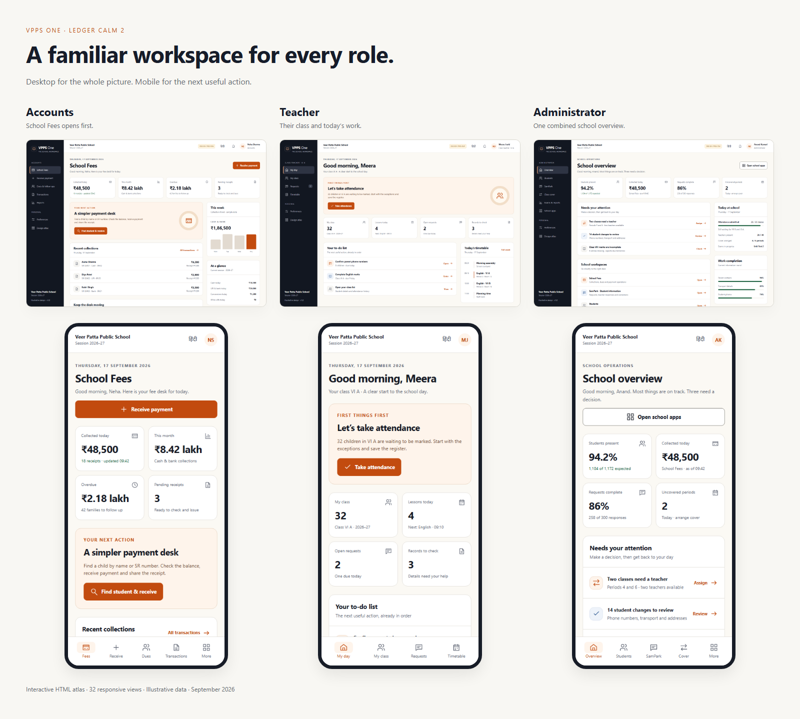

# VPPS One design atlas — Ledger Calm 2

Design version **1.0**, 17 September 2026. This is the visual implementation reference for the active R0–R8 plan, created while another agent continues implementation. It is an additive design package, not a replacement for completed work or a claim that these screens are live.

**Start here:** open [index.html](index.html) in a browser. It works directly from disk without a build or network connection. It contains **32 responsive views** with working example interactions. [overview.html](overview.html) is a presentation of the three primary roles.



## What the user should land on

| Person | First view | Phone priority | Desktop priority |
|---|---|---|---|
| Accountant / accounts staff | **School Fees** | Receive payment; find student; outstanding dues | Fee desk, collections, transactions, reconciliation |
| Teacher | **Their own class and day** | Take attendance; finish requests; next lesson | Class tasks beside the day's timetable |
| Administrator | **Combined school overview** | Exceptions needing a decision | Attendance, collections, SamPark progress, cover and exam readiness |
| Office | Student services | Find child; review changes; photos | Directory, review queue and information rounds |
| Academic coordinator | Today's academic operations | Uncovered periods first | Availability, cover workload and timetable |
| Exam coordinator | Assessment readiness | Missing entries and due work | Completion by class, marks and report review |
| View-only account | School summary | Published totals and timetable | Aggregated school overview without editing controls |

**Accountant is a School Fees role, not one of VPPS One's six staff roles.** Do not silently turn `office` into `accountant`. The fee screens are the target design for the existing School Fees app. Apply the VPPS One shell/home work in this repo and use the existing app registry for handoff. A unified sign-in landing preference requires verified destination identity and access; it must not invent a financial role. See [HANDOFF.md](HANDOFF.md).

## Package contents

| File | Purpose |
|---|---|
| [index.html](index.html) | Browse all screens and open individual responsive views |
| [prototype.js](prototype.js) | Synthetic screen compositions and demonstration interactions |
| [tokens.css](tokens.css) | Semantic colors, spacing, radii and font stack |
| [prototype.css](prototype.css) | Shared desktop, tablet, phone and print patterns |
| [DESIGN-SYSTEM.md](DESIGN-SYSTEM.md) | Visual rules, component contracts, state behavior and accessibility |
| [SCREENS.md](SCREENS.md) | Role/view rationale and implementation route-family mapping |
| [HANDOFF.md](HANDOFF.md) | Phased implementation instructions and coding-agent kickoff |
| [VALIDATION.md](VALIDATION.md) | What was actually checked, limitations and reproduction |
| [validation.json](validation.json) | Machine-readable layout and interaction evidence |
| [screens.json](screens.json) | Screen IDs, titles, descriptions and default preview personas |
| [screenshots/](screenshots/) | 64 full-page PNGs; six first-viewport PNGs; overview and atlas PNGs |
| [render.mjs](render.mjs) | Isolated, reproducible screenshot and prototype-check runner |

## Explore and reproduce

Examples: `index.html?screen=accountant`, `?screen=teacher`, `?screen=admin`, `?screen=teacher-hi`, `?screen=request-link`, `?screen=components`.

Resize the same view: the phone is a reorganized composition, not a scaled desktop. `role=teacher` and similar query parameters are **preview personas only**, never an authorization implementation.

Optional local preview: `node docs/design/serve.mjs`, then open `http://127.0.0.1:4321`. Direct file opening also works. Stop the server with Ctrl+C when finished.

From the repo root, with the existing development dependencies and Playwright Chromium installed:

```powershell
node docs/design/render.mjs
```

The runner starts a temporary localhost server on an available port, renders only these static files, checks layouts and sample interactions, writes PNGs and evidence, then closes its server/browser. It does not read app environment files, sign in, call a backend, mutate records or contact a messaging provider. No package changes are needed.

## Design direction

We considered three directions: a chart-heavy dashboard, a universal grid of app tiles, and a task-first school desk. The chosen desk makes the next action prominent and puts supporting information beside it on desktop. Charts are useful only when they help a decision; app tiles remain in the app hub. Familiar names, plain labels, stable navigation and visible save states matter more than fashionable decoration.

The palette extends the existing Ledger Calm tokens. Use warm paper, white surfaces, dark ink navigation and saffron primary actions. Use semantic colors for status, keep human-readable labels beside them, and use consistent form and list patterns across SamPark, academic work and School Fees.

All names, values and dates in this atlas are illustrative. Some operational pages use four example students while home summaries show a full fictional school. The atlas is a design reference, not a connected financial or student dataset. Prototype dialogs deliberately stop at previews. The implementation must bind existing authoritative workflows.
