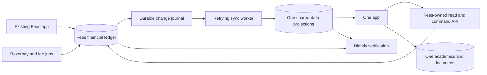

# Fees and One running together — proposed implementation plan

**Status: implementation authorized by the owner on 1 November 2026, including
live deployment and required migrations.** The design below records the original
proposal. Current implementation scope, evidence and rollout state are tracked in
`docs/cutover/COEXISTENCE-2026-11-01.md`. Proposed observation windows are not
completed verification evidence.

The owner's new direction is to keep the existing Fees app working for the school, bring real data into One automatically, and eventually allow a payment entered in either app to appear correctly in both. This replaces retirement as the goal of this proposal. Earlier cutover instructions must not be executed for this arrangement without revision.

## 1. Recommendation and what the school will experience

Keep **one authoritative financial ledger in the existing Fees database**. Keep both apps. One uses a narrow Fees-owned API for live financial reads and authorized financial actions; One retains its own database for academics and a separate, automatically refreshed view of the shared student data it needs.

This delivers two-way use: the accountant can work in Fees or, after the pilot, in One. Both entry points ultimately record a payment in the same ledger. There is one official receipt, one allocation of the money and one updated balance. One's copy is refreshed from the committed result; it does not post the payment a second time.

Examples, with proposed—not measured—timing:

- **₹2,000 collected in Fees:** the usual Fees receipt is issued. One's authoritative fee lookup can see the committed result immediately; its academic/dashboard copy normally refreshes within a minute.
- **₹1,500 collected in One:** One asks the Fees API for the latest payable amount, the operator confirms, and the source financial engine records it. One displays the returned official receipt. Fees can read the same receipt without waiting for a reverse database copy; an already-open page may need its cache refreshed.
- **Payment reversed or corrected:** the source appends the permitted reversal/correction, both apps display that result, and the official history remains intact.
- **Attendance or marks entered in One:** they remain One-owned records. They do not need to be copied into Fees, which has no equivalent workflow.

“Fees works as it is” means preserving staff screens, links, collection procedures and live operation. Reliable native posting from One requires reviewed, additive backend/API/database work on Fees. If absolutely no Fees backend changes are acceptable, the initial scope is One live reads plus a link to the existing Fees Payment Desk; that is useful but not the final native two-app payment experience.

## 2. Options considered

| Option | Benefit | Limitation | Decision |
|---|---|---|---|
| Nightly one-way snapshot | Straightforward start for reports | Up to a day stale; cannot safely drive a payment desk; replacing whole tables can damage One's own work | Optional interim read-only milestone |
| Poll APIs every few minutes | Simple, modest operational overhead | A scan by `updated_at` can miss deletes, backdated changes and late commits; needs a durable change contract | Useful transport after reliability is designed |
| One live API with no financial copy | Current balances, few duplicated calculations | API dependency; One's academic student joins still need stable local identities | Use for accuracy-sensitive financial screens |
| Shared Fees API plus durable updates to One | Preserves Fees; supports both desks; keeps academics separate; simple financial rollback | Requires contracts, identity mapping, worker and monitoring | **Recommended combination** |
| Put both entire apps on one Supabase project | Removes most database-copy work | Requires moving/reconciling One Auth, policies, academics, storage and workloads with the working Fees project | Possible future consolidation; too broad for the initial change |
| PostgreSQL CDC/logical replication | Captures committed changes across many write paths | Schema evolution, replica identities, WAL retention, consumer recovery and permissions require ongoing operations; still does not make two money writers safe | Alternative if the outbox proof proves insufficient |
| Two independently writable financial databases with two-way copying | Each app appears independent | Concurrent payments, receipt numbers, waivers, refunds and household edits need conflict resolution; “last edit wins” can corrupt money | Do not choose |
| One opens the existing Fees desk for edits | Removes duplicate payment-engine work from the first release | Operator temporarily leaves One to collect | Recommended first live phase |

Current Supabase guidance distinguishes browser Realtime updates from maintaining a database copy. Managed Pipelines is alpha and the currently listed destinations are analytics systems; it should not be assumed to provide a ready-made two-Supabase bridge. These facts support evaluating our own small durable worker or a separately proven CDC consumer. [Supabase replication](https://supabase.com/docs/guides/database/replication).

## 3. Architecture

The API should initially live in the existing Fees backend, avoiding another financial application or another copy of its privileged database credentials. The worker may run as a bounded Supabase function/job. Verify runtime limits and source capacity in the proof; no paid service is assumed or purchased by this plan.

The existing Fees app can continue calling its established financial functions. One's gateway invokes those same functions through audited wrappers. Moving every existing Fees screen to the new HTTP API is not a prerequisite. Shared database rules remain the authority under both entry paths.

No change to One's global `NEXT_PUBLIC_SUPABASE_URL` is proposed. It currently identifies One's Auth and academic database as well as its local fee clients. Repointing it would affect much more than fees. The existing guard against direct access to the Fees project should remain for normal One clients; the new integration gets a separate, narrowly scoped server API client.

## 4. Ownership and permission boundaries

| Data or operation | Authority | What One may do |
|---|---|---|
| Students, admission identity, real sessions/classes, shared contact fields | Fees initially | Read; later submit approved version-checked commands |
| Household membership, contact preferences and payment-access snapshots | Fees | Use current canonical household APIs; never infer siblings from a shared phone |
| Fees, installments, discounts, waivers, dues, balances, EMI | Fees financial engine | Request current calculations and authorized commands |
| Payments, receipts, allocations, corrections, refunds, reversals | Fees financial engine | Display and print canonical results; submit audited commands |
| Receipt numbering and posting locks | Fees database | Accept the returned number; no independent real receipt counter/floor |
| Razorpay orders, captures, callbacks and reconciliation | Existing Fees integration | Use its existing payment URLs and read status; later request actions through the same owner |
| Fee receipt/reminder/reversal messages and callbacks | Existing Fees messaging workflow | Display status; later request an authorized send through its existing policy and outbox |
| Financial scheduled jobs and day close | Existing Fees scheduler | Read results; no duplicate charge, posting or close job |
| Attendance, marks, timetable, teaching assignments, school notes | One | Own and edit through One's existing authorized workflows |
| Collection answers about a student's shared details | One until accepted | Keep proposals; an approved correction becomes a canonical Fees command, then returns via the feed |
| Staff accounts and access | Each app's Auth plus explicit bridge grants | No password/hash copying, automatic account linking or privilege promotion |
| One academic files | One storage workflow | Preserve file ownership, access and academic references; no bulk storage/auth replication |
| Fees MCP, existing Notion reports and fee exports | Existing Fees ledger | Remain current because the ledger stays authoritative |

Define field ownership as well as table ownership: the current canonical class/status may come from Fees, while One owns historical enrolment, teaching assignments and academic records. A source class transfer must follow an explicit academic transition rule; it must not rewrite historical roll/class associations or silently grant access to old records.

For commands, the Fees API validates the calling application and actual signed-in One user. Verify token issuer, audience, expiry and signature; never accept a role or staff ID merely supplied by the browser. One's Auth identity must map explicitly to a permitted canonical financial actor or a reviewed source-side bridge grant. No mapping means no command access. Recheck active account, action, session and student scope at execution. One's wider academic role cannot silently grant wider financial access.

Use per-user source audit attribution with `origin_app`, verified actor, command ID and affected record IDs. Keep service keys server-side and out of One's browser; do not implement a generic table/RPC proxy. The source API must expose explicit operations, not arbitrary SQL or caller-selected RPC names. Authorization failures or unavailable identity verification fail closed for commands.

Supabase supports validating asymmetric user tokens with its project JWKS, while legacy symmetric-token validation requires the appropriate Auth-server path. Confirm the actual signing mode rather than sharing JWT signing secrets or assuming tokens from two projects are interchangeable. [Supabase JWT verification](https://supabase.com/docs/guides/auth/jwts).

## 5. Data access and automatic updating

Use **live API reads** for Payment Desk quotes, fee balances used for collection, final receipts, reversals, household payment eligibility, payment links and official financial exports. A stale local projection never authorizes a monetary operation. Return the canonical balance after the transaction rather than subtracting an amount from a cached screen total.

Canonical financial reads must bypass stale server/browser caches or enforce a verified source revision barrier. After a command commits, invalidate affected Fees server caches; after projection application commits, reliably invalidate the affected One caches. Refresh already-open browser screens through event hints, with focus/reconnect and bounded polling recovery. Shared database state does not invalidate two separate Next.js caches automatically. Preserve the returned canonical result until an equally new or newer refresh arrives; an older projection must never replace the confirmed receipt/balance. Measure database visibility and visible screen refresh separately.

Use **One projections** for academic rosters, class selection, student identity links and lightweight fee-status badges. Store only fields needed by these features, with source identity, contract version, revision, state and last successful refresh time. Put them in dedicated `vppsone` tables without money-posting, repricing or notification triggers. Do not copy into today's full local fee schema and accidentally execute its business side effects.

Time-derived values need an explicit IST calculation date and expiry. A due date crossing midnight can change an overdue/late-fee badge without any database mutation. Schedule refresh/invalidation at the relevant date boundaries as well as consuming row changes; expired cached values cannot determine a collection amount.

Proposed operating targets, to measure before promising them:

| Path | Target |
|---|---|
| Payment posted from One | Canonical receipt returned after source commit; no queue-delayed financial acknowledgement |
| New source change visible in ordinary One views | Normal p95 within 60 seconds |
| Background drain | Approximately every 30 seconds, with one bounded worker/lease initially |
| Stale projection indication | Visible last-updated time; warning after 2 minutes |
| Backlog alert | Oldest unprocessed event over 5 minutes or repeated failures |
| Financial comparison | Nightly, provisionally 02:00 IST, after checking existing job contention |
| Operational review | Operator checks failures each school morning; immediate escalation for money mismatch |

Supabase Cron supports sub-minute schedules and bounded SQL/HTTP jobs. Actual cadence and capacity need a proof on the chosen runtime. A scheduled wake-up is not the financial journal. [Supabase Cron](https://supabase.com/docs/guides/cron).

### Durable changes, not best-effort browser events

Add a small **persistent source change journal/outbox** in a source-owned integration schema. A financial/master-data transaction records the relevant change indication in the same database transaction as its business change. Capture coverage must include the current Fees screens, imports, manual corrections, jobs, provider webhooks and future approved writers—not only new One API calls.

The worker claims committed, unacknowledged entries using leases and bounded batches; refreshes a coherent current source aggregate under a consistent read; applies that aggregate to One atomically; and then acknowledges only the claimed entries. The journal is a durable instruction to refresh authoritative state. It is not an instruction to run `post_student_payment` again in One.

Required details:

- Stable event IDs, source/contract version, affected aggregate keys, attempt count, lease expiry and last error. Payloads should minimize personal data.
- Poll all unacknowledged work. **Do not advance a single maximum ID or timestamp and assume lower IDs have committed.** A later-ID transaction can commit before an earlier one.
- Fenced per-aggregate application, with source revision checks, prevents an old/retried worker from overwriting a newer refresh. One target commits data and its checkpoint together.
- Changes spanning a household or payment must refresh the complete relevant bundle: receipt, allocations, student/household state and dependencies. Fan-out for a class/fee-rule change is itself durable and resumable.
- Relationship events must identify both old and new household/class/session scopes. Refresh overlapping scopes with consistent lock ordering and revision checks so a household move cannot leave stale membership or let an older bundle overwrite a newer one. An incomplete response is an error, not evidence that omitted records were deleted.
- Deleted/retired records need tombstones and versioned retirement handling. Financial history stays append-only; no deletion in the mirror may cascade into One-owned academic history.
- Delayed/out-of-order and repeated work must converge. A crash after target commit but before source acknowledgement causes a harmless repeat.
- Quarantine poison events and alert; never acknowledge an unsupported schema or failed record just to make the queue look empty. Retain unresolved work; propose at least 30 days of acknowledged-event retention subject to capacity review. A retention gap requires a new bootstrap, not skipping ahead.
- Capture transaction failures cannot be silently ignored. Test source performance and failure behavior before rollout. An emergency removal of capture must create a recorded coverage gap and force reconciliation/rebootstrap.

An optional webhook may wake the worker sooner, but polling the durable journal recovers lost wake-ups. Supabase database webhooks are asynchronous; the underlying `pg_net` request/response tables are unlogged and are not a durable substitute for the financial change journal. [Database webhooks](https://supabase.com/docs/guides/database/webhooks), [pg_net limitations](https://supabase.com/docs/guides/database/extensions/pg_net).

Supabase Queues is an alternative durable queue implementation to evaluate during the proof. Its visibility window still requires idempotent target processing and safe retries across database boundaries; it does not make a two-database business transaction exactly once automatically. [Supabase Queues](https://supabase.com/docs/guides/queues).

If the aggregate-outbox approach cannot prove coverage/consistency at reasonable complexity, select a real CDC consumer instead. Then initial snapshot and replay must be tied to the replication slot's snapshot/LSN, committed transactions must apply coherently, and WAL retention and slot health need monitoring. PostgreSQL does not replicate schema DDL or sequence state automatically. [Logical decoding](https://www.postgresql.org/docs/17/logicaldecoding-explanation.html), [logical replication restrictions](https://www.postgresql.org/docs/17/logical-replication-restrictions.html).

### Starting while Fees remains live

1. Complete the reviewed identity cleanup in One and create an unpublished projection generation.
2. Enable capture for the whole agreed source write surface and verify it is committed before taking the source snapshot. Test transactions that straddle capture installation; use bounded migration locks and abort deployment if busy rather than blocking the desk indefinitely.
3. Take one consistent source snapshot using the sealed read path. Import into the unpublished generation, with source IDs and a manifest of counts, exact monetary values and hashes. Do not import Auth, secrets, scheduler settings or send queues as executable state.
4. Keep all captured changes while copying. Do not let a late bootstrap batch overwrite newer live-applied data; finish the base generation first, then consume retained invalidations against current canonical state.
5. Apply the retained changes, including creations and deletions during the snapshot. Compare matching revisions, required references and known transactions; publish only once caught up within the agreed freshness limit, by atomically switching the active generation pointer. Fence workers by generation during publication. Acknowledge events only after their intended target generation commits. Resume that generation after a crash; if it is abandoned, reset consumer coverage and bootstrap anew rather than reuse its acknowledgements as proof for another generation.
6. Keep consuming. Refreshes update projection-owned data only and never overwrite new attendance, marks, notes or files created in One.

The bootstrap proof must include insert/update/delete both during the initial copy and during a long-running transaction. A gap-free handoff is an acceptance test, not an assumed property of a timestamp.

## 6. Payments and other edits from One

Proposed contract families (exact route names are implementation choices):

| Contract | Purpose |
|---|---|
| Student/session/household read | Role-scoped identity and current canonical shared fields |
| Financial summary and payment quote | Current due, allocations, allowed amounts, waiver eligibility and a versioned quote |
| Post payment | Authorize and atomically invoke the existing financial engine; return canonical receipt and resulting balance |
| Command status | Resolve a retry or lost response by stable command ID |
| Receipt/detail/print/export | Return source facts and approved document output with the same session permissions |
| Correction/reversal/refund | Explicit, permission-specific, append-only operations; never edit a copied receipt |
| Student/contact/household command | Validate proposed edit, expected revision, access-link consequences and source policy |
| Waiver/concession/EMI/fee setup | Explicit operation-specific commands introduced only after parity tests |
| Fee-message request/status | Use the existing fee policy/outbox; no second independent sender |

Command processing must use one source database transaction for the durable request record, financial mutation and required outbox work. Reuse existing locks, `client_request_id` and the payment-with-adjustments engine. Existing idempotency is necessary but must be checked across the whole wrapper; two separate HTTP calls for “record request” and “post money” are not atomic.

The same command ID and identical normalized payload return the same completed result. Reusing that ID for a different payload is rejected. A stale quote must be revalidated against current source state and either recomputed for operator confirmation or rejected before posting. Different legitimate payments must not be collapsed merely because student, amount and date match.

Persist the original command ID and necessary normalized payload securely before dispatch, so a page reload or client crash can resume the same inquiry. Scope source uniqueness to the calling app and ledger/environment; retain outcome records for at least the agreed retry/reference period and reject expired keys instead of treating them as new. Status/result reads recheck the current actor's receipt/session permissions; knowing a command ID is not authorization. Avoid leaving financial payloads or credentials in general browser storage.

If the response is lost after commit, One shows **“Checking whether this payment was saved”**, disables blind resubmission, and queries status using the original ID. A shared collection reference/status lookup must be available when staff switch to Fees. Never tell them to create a fresh payment simply because One timed out. A pending inquiry is not an offline committed receipt.

Preview and local One deployments have no real-command credentials/permission. TEST bridge fixtures are explicit Fees `TEST-2026-27` identities with a separate mapping. The same session label on two databases does not prove fixture identity. Source checks the actual record's session and the verified actor; a forged real student ID must fail. One's local synthetic fee engine may remain for isolated tests but is never a fallback for an unavailable live API.

The approved One Payment Desk default late-fee waiver remains a proposed UI default only where the canonical operator has the waiver permission and the combined source transaction supports it. Preserve the reason and explicit amount in the audit. Do not change the existing Fees default silently.

Every enabled real action must have a row in an operation inventory: screen/action, owning domain, canonical API, permissions, TEST behavior, side effects, recovery and evidence. Until a command is implemented and accepted, its One button opens the existing Fees workflow or is visibly unavailable. Native and ported financial paths both need coverage.

## 7. Receipt, provider and message ownership

Keep the current Fees Razorpay webhook, order/capture reconciler and automatic-posting path as the sole financial owner. Existing parent payment links remain valid. One can open those links or request a link through the same source service. Do not enable a second One `vp1_` posting path for the same collection.

Keep canonical provider-event deduplication and a separate uniqueness rule for the underlying payment effect. Razorpay documents duplicate events and non-guaranteed arrival order; an extra webhook on One would not solve synchronization. [Razorpay webhook validation and idempotency](https://razorpay.com/docs/webhooks/validate-test).

Receipt PDFs and verification must refer to the same canonical receipt. One may initially return the existing Fees-generated document or render the canonical payload with a checked template. One's `/rv` should query/delegate to canonical verification with the same minimal disclosure, not authenticate a separate local receipt.

Fee receipt messages, reminders, reversal messages, delivery callbacks and fee-event staff alerts stay under the Fees owner initially. A source commit from One must schedule required side effects reliably; do not omit them because current Fees UI normally performs some work after posting. Do not send them again on projection apply. Existing provider “delivery unknown” rules still apply—automatic retries must not promise exactly-once WhatsApp delivery.

Use stable business-key uniqueness for each required notification/alert across existing Fees screens, jobs and the new wrapper. Moving required enqueue work into the source transaction must not double-enqueue when the existing Fees post-payment code also runs. Preserve explicitly requested, authorized resends as separate audited operations.

One's attendance/academic staff messages are a separate later rollout with its consent and category controls. They are not prerequisites for live roster visibility or One payment entry. New `_v7` templates pointing at One are optional if parent payment URLs continue to use Fees; they should not delay the initial coexistence milestone.

## 8. One identity cleanup and the household changes

The 1 November readiness evidence found missing household structures: 15 public tables, two private views, 19 columns in five existing tables and 28 exposed RPCs. The newer merged [PR #151 readiness report](https://github.com/veerpatta/vppsone/blob/de277a8/docs/cutover/READINESS-2026-27.md) records ten populated missing tables containing 7,772 rows, superseding the earlier nine-table / 7,771-row lower bound. One table has a row but remains unreadable by the REST extraction service role. These are recorded observations from those reviews, not a new live scan in this planning task.

With an API-based design, One may not need copies of every internal source table/function. It must have a complete **explicit contract** for required students, household/contact rules, financial status and source identifiers. Each previous difference is classified as source-internal/API-owned, projected, or unsupported-and-blocked. Nothing necessary may be silently discarded. The unreadable source table's exposure issue can be addressed through a purpose-limited source aggregate reader; do not widen public privileges merely to make a generic extractor succeed.

Before real names are published in One, separate existing masked activity from real identities. Some copied UUIDs refer to real source children while One's marks/attendance were test work. A roster replacement alone would attach that work to real children.

Reuse the reviewed quarantine mapping as a starting point: TEST-D student shells, TEST class/staff twins and audited remapping of foreign-key and non-foreign-key references, including arrays. Resolve the two held staff identities and owner-declared real activity first. Preserve genuine academic files and work explicitly. The original enrolment/class-teacher schema deliberately lacks public-table FKs, so inventory actual later constraints, SQL joins and plain UUID references rather than assuming the database will catch every mistake.

PR #151 also records four real Fees users whose matching One profiles remain TEST, plus unresolved receipt balance-after/paid-so-far presentation examples. Resolve account mapping explicitly before access acceptance. Canonical receipt facts remain authoritative; obtain or reproduce the four redacted examples before deciding any alternate display wording/calculation. Do not silently promote profiles or retain divergent arithmetic.

Real registry identities use the canonical source project/student UUID; local TEST identities must be distinguishable and safely mapped. Move native academic reads and any SQL dependencies to the new identity/projection boundary before retiring old masked data. This is a controlled migration with a backup and rollback proof, not a nightly deletion/reload.

## 9. Nightly checks, failures and recovery

Nightly comparison supplements automatic updates; it is not the only mechanism making a payment visible.

Compare source and projection at **matching source revisions/snapshots**. Record revision and contract/hash provenance for each aggregate. A newer source version during comparison is pending catch-up, not proof of corruption; retry that scope. Do not claim global equality from two queries taken at different times. Require complete aligned coverage or an explicitly unfinished result. Official school-wide totals continue to come directly from one canonical source snapshot.

Individual aggregate revision matches are not a global point-in-time equality proof. If local school-wide report totals are required, build a staged reporting generation from one source snapshot and the same IST as-of calculation day, validate it against that snapshot, and publish it atomically. Check source materialized-view freshness or use canonical base calculations; an out-of-date source view cannot validate a fresh balance. The ordinary incremental projection may contain mixed-age aggregates and must not present those totals as an exact current source snapshot.
Checks are scoped to the agreed contracts. Directly compare projected student/class/session counts, household/contact fields, fee summaries and their revisions. Separately verify canonical receipt identities/numbers/amounts, allocations, reversals/refunds, previous-year dues/EMI, captured-versus-posted-versus-review invariants and source-origin command linkage; test One's API/PDF presentation against those source facts. This does not require copying every raw ledger table into One. Check pending/retried events, freshness and contract versions as well. Use exact money representations rather than floating-point tolerances and document every deliberate scope exclusion.

Repair a damaged projection by re-reading canonical state into an isolated generation/aggregate and atomically replacing only projection-owned rows. Never “repair” by posting money again, rewriting source history or deleting One academics. Back up both systems' owned data; a projection is rebuildable, while One marks/documents and the Fees ledger are not disposable.

| Failure | Behavior |
|---|---|
| One unavailable | School continues in Fees; no financial replay/re-entry later |
| Feed/worker delayed | One labels projections with their age; canonical API reads still determine money; unsupported stale academic decisions are paused |
| One-to-Fees API unavailable, Fees site works | Stop new One financial commands; resolve existing command IDs before collecting again; use Fees |
| Canonical Fees database unavailable | Neither app claims a payment saved; use the school's agreed manual outage process |
| Worker crashes after target commit | Retry is deduplicated/fenced; acknowledge only after committed application |
| Unknown schema/version or bad data | Pause affected projection, alert, retain event, keep Fees operating; do not silently drop fields |
| Money mismatch or duplicate side effect | Disable One command family, preserve evidence, investigate canonical ledger; no automatic reverse entry |
| Source capture causes performance/errors | Roll back additive capture safely, record gap, keep authoritative Fees data; rebootstrap before claiming One current |

Rollback is generally **turn off One integration and continue Fees**, not move balances back between databases. Once One is an entry point into Fees, its committed payments are already in Fees.

## 10. Delivery stages and acceptance

| Stage | Deliverable | Required evidence before widening |
|---|---|---|
| 0. Design and inventory | Domain ownership, operation matrix, identity mapping, API/feed choice, revised instructions/runbooks | Every shared financial writer and current side effect accounted for; implementation scope agreed |
| 1. Synthetic proof | Canonical read/command stub plus durable feed and bootstrap in an isolated test setup | Concurrent writes, late commits, lost responses, retries, deletes, schema changes and consumer restarts pass |
| 2. Source read bridge and safe One preparation | Narrow read APIs; backup; real/TEST identity separation; dedicated projections | No accidental real write/send, no academic-history loss, permissions/TEST fences verified |
| 3. Live read-only One pilot | Real rosters/financial reads; actions open Fees; durable incremental refresh and nightly report | Proposed seven consecutive clean daily checks, measured lag, accountant/teacher mobile acceptance |
| 4. One payment pilot | Narrow collection commands for named admin/accountant users | TEST acceptance first, then separately approved real pilot; lost-response recovery and concurrent use of both apps; proposed seven clean operational days |
| 5. Remaining actions | Corrections, waivers, refunds, student/household edits and other command families, each separately enabled | All enabled actions in the inventory tested; unsupported actions continue in Fees |
| 6. Routine coexistence | Both apps remain available; operator monitoring, backups and contract checks | Named owner, recovery drill, acceptable source performance and no unexplained mismatches |

The two seven-day observation periods are proposed acceptance windows, not dates already approved or completed. They can overlap only where the same evidence genuinely covers the relevant enabled behavior. Read-only One can be useful before every financial action is integrated. There is no compulsory retirement date for Fees.

Must-pass cases include:

- Cash, UPI, cheque, online capture, part payment, existing overpayment policy, discount/waiver, family allocation, carry-forward, EMI and adjustments.
- Identical command replay many times gives one effect; same key/different payload fails; a different legitimate collection remains possible.
- Browser reload/client crash preserves the original command and resumes status checks; bootstrap/worker restart preserves or explicitly rebuilds the intended generation and coverage.
- Two desks/apps operating on the same student/household obey source locks, version checks and receipt uniqueness.
- A source import/job/webhook is captured without requiring a user to open One.
- TEST actors cannot touch real records; disabled users and missing actor mappings fail; teacher-only access cannot collect unless explicitly granted the relevant canonical permission.
- Receipt + allocations + displayed balance are coherent; applying a projection creates no financial transaction or message.
- One-native academics survive bootstrap, replay, recovery and schema upgrades.
- Accepted household/contact changes invalidate/revalidate relevant payment links through existing canonical rules.
- Refresh/cache invalidation works in already-open Fees and One pages; test at mobile width and on the office printer. Report physical-device testing only when actually performed.
- Midnight/date-boundary refresh updates time-derived dues consistently, with the same IST as-of day in reports and comparisons.
- One rollback after a confirmed payment requires no copying or re-posting into Fees.

## 11. Concrete implementation work packages

| Work package | Proposed implementation location | Dependency |
|---|---|---|
| Contract schemas and operation inventory | Versioned bridge contract; both repos validate compatibility | First |
| Source read/command authorization | New narrowly scoped Fees server routes, actor mapping and source transaction wrappers | Contract + owner-approved source changes |
| Source durable capture | Source integration migration, outbox/aggregate revisions, all-writer capture tests | Full mutation inventory |
| Worker + bootstrap | Bounded integration worker, projection apply RPC, checkpoint/lease/recovery tooling | Capture + identity model |
| One adapters | Explicit financial read/command layer replacing real use of local fee clients | Source contracts |
| Native student/academic transition | `src/modules/students`, fee-standing reads, platform session fences, actual SQL dependencies | Quarantine + roster projections |
| Receipts and exports | Canonical payload/document adapters, verification route, signed downloads | Source authorization and receipt contract |
| UI states | Current/stale timestamps, pending command recovery, supported-action routing | Status APIs |
| Operations | Monitoring, reconciliation, backups, contract CI, updated runbooks | All earlier proofs |

Repository inspection found 112 files importing ported fee server/admin clients and 22 native/platform files with explicit fee-schema access, plus roughly 50 migration references to public student/class/receipt/payment/view objects. These counts overlap and are not a count of separate features. They show why this is a staged data-layer integration rather than a two-client URL change.

Proposed seams include `src/modules/fees/platform/supabase/*`, `src/platform/auth/test-session-access.ts`, native and ported payment actions, native student/fee-standing reads, `/rv`, receipt/export routes, and job dispatch. The real-command adapter must cover both the ported desk and the native One desk. Scan for bypasses in architecture tests before enabling each command family.

Reuse the existing financial business engine and test cases. Add tests for new contracts, permissions, capture, command recovery and projection semantics. Do not rebuild financial calculations independently in One. Schema/API evolution uses compatible additive changes, explicit contract versions and consumer checks; retire old fields only after both apps stop using them.

## 12. What changes from the previous cutover plan

| Existing work/instruction | New treatment |
|---|---|
| UI, session pill, role precedence, TEST fences, receipt/export work | Retain and adapt |
| Backup/restore and classification/quarantine tooling | Reuse after reviewing assumptions for projections and academic preservation |
| Public sign-ups off, no automatic profile trigger, pre-send email check | Retain |
| Household parity blocker | Resolve through explicit canonical API/projection contracts; no blind omissions |
| Stop Fees collecting / make it lookup-only / disable its New payment links | **Do not execute for coexistence** |
| Activate One's independent fee engine, Razorpay posting, day-close and fee-message workers | **Do not activate for the same real financial data** |
| One-specific real receipt suffix floor / manual re-entry of tail receipts | Not part of this design; the source ledger already has each receipt |
| `tail-sync.mjs` | Historical cutover-review tooling, not the ongoing feed |
| Repeated `load-snapshot --apply` | Not an ongoing mirror refresh; replace with projection-aware bootstrap/apply |
| “Fees quiet” and post-cutover divergence checks | Replace with continuous canonical/projection and origin-command checks |
| Freeze existing Fees MCP / Notion | No freeze needed while Fees remains authoritative |
| One `_v7` campaigns and separate parent pay host | Optional later product decision |
| Old rollback copying One payments back to Fees | Replace with disable-integration and canonical-command reconciliation |

This proposal changes prior retirement and source-write restrictions at the design level. It does not itself permit a live write. If adopted for implementation, update `CLAUDE.md`, target guards, architecture tests and runbooks explicitly to permit only the new named API boundary; preserve the prohibition on arbitrary direct source writes.

## 13. Decisions, effort and first milestone

Recommended defaults for approval when choosing to implement:

1. Fees remains the financial authority and stays available indefinitely.
2. Additive backend integration is allowed, with existing staff workflow preserved and measured regression checks.
3. First milestone is real student/academic use and live financial visibility in One, with collection opening Fees. Native One payments follow the proven bridge.
4. Aim for under-one-minute projection updates plus nightly verification; financial quotes/posting always consult the source.
5. Keep current parent payment URLs, fee-message workflows and financial scheduler ownership in Fees initially.
6. Use a small named pilot group; decide the shared-field edit authority and which later commands must be native in One.
7. Resolve the held teacher profiles, four real-user/TEST-profile mappings, TEST contacts, owner activity and receipt presentation examples before the relevant real acceptance. Name an operator/accountant for daily exception review.
8. Review hosting capacity, durable worker and recovery cost before any paid change. A plan upgrade is not automatically required merely because this design exists; its need must be assessed from actual limits and recovery requirements.

Rough planning allowances—not a delivery commitment: 2–4 engineering days for inventory/contracts/proof; 4–8 for safe continuous read projection and read-only pilot preparation; 5–10 for core collection integration; another 5–10 for broader commands and recovery hardening. Some work overlaps, and the discovery proof may change these ranges. Observation windows, school acceptance and decisions add calendar time. A full two-app financial experience is a project measured in weeks; the useful read-only milestone should come first.

Deliver the implementation in small reviewed PRs, with an evidence gate before each live enablement. Keep the current readiness report as the historical result for the earlier cutover design, and create a separate coexistence acceptance checklist. The intended outcome is both apps working together reliably, not a forced transfer of the school's working fee system.

## Evidence used and limitations

This plan uses the 1 November readiness/canonical-schema evidence and read-only local repository inspection. No production DB, app configuration, provider, permission, campaign or financial operation was changed for this planning task. Today's live observations were not silently treated as a permanent guarantee; refresh the source/deployment/contracts when implementation starts.

Local evidence: `docs/cutover/READINESS-2026-11-01.md`, current `CLAUDE.md`, fee Supabase clients, native payment/student/session code, migration/import/tail tooling, and the old cutover/parallel-run documents. The newer merged readiness report was read from `origin/main` at `de277a8` using `git show`; the working checkout remains at `da37090` with local documentation changes. PR #151's fixes and reported verification are retained as evidence, not represented as tests rerun by this planning task. Independent design reviews are under `D:\Codex\scratch\vppsone-coexistence-plan-2026-11-01\` (`architecture-review.md`, `sync-review.md`, `rollout-review.md`). External technical claims link to official PostgreSQL, Supabase and Razorpay documentation at the relevant point above.
