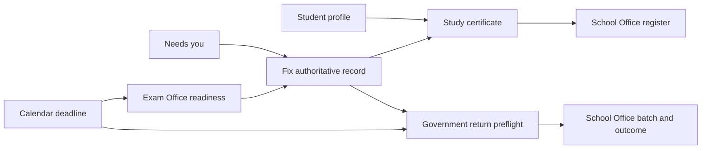

# Rajasthan school operations in VPPS One: proposed experience and delivery plan

1 November 2026. **Selected direction: integrated actions plus a School Office register.** The owner selected this approach during the planning discussion. The detailed design and rollout below remain a proposal for review; this document adds no product functionality or live changes.

The aim is to let the office complete ordinary school work using records One already knows: issue a study certificate, correct a missing fact once, prepare an official return, and track the actual outcome. Start with a complete study-certificate workflow. Extend the existing student, inbox, calendar and exam experiences as later workflows become usable.

## 1. Approaches and recommendation

| Approach | What staff would experience | Tradeoff |
|---|---|---|
| Certificate tools first | Generate and reprint study certificates from a student profile; a small register | Fastest narrow release; government work needs a subsequent organizing surface |
| Dedicated School Office area | Open a new workspace for certificates, returns, readiness and results | Easy overview; risks a second version of student records, task lists and Exam Office |
| **Integrated actions plus a small School Office register** | Act from the student, Needs you, Calendar or Exam Office; use School Office to find certificates and return batches | Best fit with the existing app; needs consistent links, permission rules and shared state |

**Selected approach: the third, delivered certificate-first as the proposed rollout.** School Office is the office's register and return workspace. Existing screens remain the place to work on a student, resolve an exception or manage examinations. The owner chose the integrated approach; certificate-first sequencing and the detailed implementation decisions are this plan's recommendations.

## 2. What exists and what must be added

Read-only baseline: local `main` is `da37090`; the recorded `origin/main` is `c3c05f1`, also the research report's code baseline. Newer bridge files were inspected with `git show origin/main:...` without moving the dirty checkout. No live application, private database rows or portal account was inspected. Refresh the branch and instructions when implementation starts.

| Existing foundation | Reuse | New work |
|---|---|---|
| Student 360, including the Documents and History tabs; one reader for full page and drawer | Student context, session, existing attachments, return-to-list behavior | Study-certificate action, issued-document section and issue events |
| `src/vx/nav.ts`, shared search and quick actions | Permission-filtered desktop, Menu and search destinations | One School Office destination; contextual certificate action |
| Today and Needs you | Owned, actionable exceptions with direct links | Certificate blockers and return conflicts, grouped without duplicate alerts |
| `src/vx/ui/{page,primitives,controls,overlays}.tsx` and `vx.css` | Cards, lists, chips, bilingual labels, sheets, toasts and motion | Feature-specific composition, not another component library |
| Bilingual PDF kit and report-card issue snapshots | Fonts, letterhead, immutable issue/reissue and command patterns | Certificate layout, independent serial series and issuance policy |
| Current Fees bridge and canonical academic identity guards | Authorized current student facts and stable IDs | Explicit certificate field coverage and source revision contract |
| SamPark staging, matching and protected record writer | File checks, identity resolution, preview and provenance | Destination-specific adapters and allowed-field mappings |
| Existing record-quality, Calendar and Exam Office screens | Familiar exception lists, deadlines and examination navigation | Purpose-specific rules, sourced dates and external outcomes |

Uploaded birth/transfer documents are attachments; they do not establish a certificate issuance register. Internal report-card results do not establish official board outcomes. Current source instructions keep Fees as the financial authority; this feature must use the bridge and existing ownership rules.

## 3. Where each task belongs

| Surface | Proposed addition | Interaction |
|---|---|---|
| Student 360 | A visible secondary **Study certificate** action for authorized issuers; Documents shows **School-issued** and **Uploaded** sections | Generate for this student; view/reprint an existing issue; keep current drawer, tabs and list position |
| Today | At most one relevant office-work summary when there is outstanding work | Examples: certificates needing details, returns needing correction; open the filtered queue |
| Needs you | Actionable missing facts, identity conflicts and rejected return rows | Show student, reason, responsible person and **Fix details** or **Review difference**; remove resolved items automatically |
| School Office | Certificates register first; **Government returns** added when that workflow ships | Search student/SR/serial; filter session/type/status; resume a batch; open issue history |
| Promote & import / record quality | A purpose selector such as **Study certificate** or **PSP: selected module** | Reuse the list interaction, but validate only that purpose's requirements |
| Exam Office | **Board readiness** and, later, **Official results** | Link the relevant authority/session/attempt; keep internal examinations in their existing views |
| Calendar | Source-backed official deadlines linked to their readiness or return batch | Show applicability, source and verification date; ambiguous dates say **Needs verification** |
| Settings | School identifiers, approved certificate template, series and signatory policy | Occasional configuration; version changes affect future issues |

Add **School Office / विद्यालय कार्यालय** to the admin/office People group and phone Menu, subject to permissions. Keep the current bottom tabs and center action. Search can find the register and initiate a certificate by selecting a student. The quick-action sheet may gain **Study certificate**; it first selects a student and then uses the same command.

Ship only working destinations. The first release exposes the certificate register, not empty PSP, RTE or results tabs. School Office can link to Exam Office's readiness view; it must not maintain a separate editable readiness checklist.

## 4. Make the feature look and behave like One

Use the current VX design rather than the older warm/saffron design atlas. The inspected application uses a navy sidebar (`--nav`), blue primary action (`--pri`), teal accent (`--acc`), pale background, white cards and existing dark equivalents. Preserve its serif page titles, Inter/Devanagari text, 18px cards, chips and labeled status pills. Use shared tokens rather than copied hex values.

- **Desktop:** register table with student, class/session, type, serial, status, issue date and issuer; search and filters together; selecting an issue reveals its details and permitted actions. Existing Student 360 stays its 640px drawer. Use the existing Sheet as a centered dialog for short certificate exceptions; do not introduce another drawer system.
- **Phone:** one-column issue or batch cards, names and reasons allowed to wrap, 16px inputs, 44px minimum controls and a prominent comfortable primary action. Sheets use the existing bottom-sheet behavior. Complex return comparison opens a full page. Sticky actions clear the keyboard and safe area.
- **Language:** follow the reader's `en`, `hi` or `both` preference through VX language helpers. Keep feature strings local to the route where practical; do not mix the VX and fee `next-intl` catalogs. The certificate's approved language is explicit and recorded with its issue; changing UI language never alters an old PDF.
- **Feedback:** show Preparing, Ready, Needs details, Needs signature, Failed or Unavailable as applicable, using text and icon as well as color. Keep **Retry** attached to the same operation. An inaccessible source is not an empty register or a successful certificate.
- **Continuity:** preserve URL-backed session, filters, selected batch and return path. Back closes the relevant layer and returns to the same list position. Focus returns to the trigger. Use existing motion and reduced-motion behavior.
- **Clarity:** prefer specific copy such as “Admission date is missing” or “7 records need a medium selected.” Avoid a global completeness score that can hide a mandatory blocker.

All illustrated counts and example labels in this proposal are fictional. No actual deadline, school policy or statutory requirement is inferred from them.

## 5. First complete workflow: study certificates

### Routine path

1. An authorized issuer opens the correct student and enrolment/session. The action says **Study certificate** if a new issue is appropriate, or offers the existing issue for reprint. Creating another issue remains an explicit separate action.
2. The server checks current staff access, test/live scope, approved template and signatory policy, canonical identity, source provenance and required fields. It reads the facts; the browser cannot supply an arbitrary certificate body or signature.
3. A ready record produces the PDF immediately. Show the serial and **Download** / **Print** with a link to its register entry. No routine principal-approval screen is introduced.
4. A missing fact opens a short exception sheet with only the required fields and their authoritative edit links. Preserve the pending task and offer **Continue certificate** after the correction is confirmed. Recheck before issuance.

Do not require a phone, Aadhaar, fee clearance, guardian name, DOB or purpose unless the approved template and applicable use require it. Existing record-quality dismiss/skip behavior cannot waive a mandatory certificate field. A source outage blocks a new issue with a useful retry; an authorized reprint of stored bytes can remain available.

Historical enrolment uses verified period-specific facts and past-tense wording. If more than one enrolment could apply, ask for the relevant period. Do not describe a former student as currently studying or guess an admission date from record creation time.

### One-time school decisions

Before issuing real documents, settle the template wording and language, genuinely required fields, school identifiers to print, serial/year convention, eligible issuers and signature/seal policy. Use the school's existing blank specimen if available; otherwise prepare a draft with its current letterhead for one-time wording/layout approval. A missing existing template need not prevent design work. Existing signature-image assets do not authorize their use for a new document.

When authorized electronic/facsimile issuance is permitted by the agreed policy, the routine click can issue immediately. When a physical signature is required, label the PDF **Prepared - signature required** and retain the signature area. A later recorded handover/signature step follows that policy; it is not an invented approval for every print.

For physical signatures, keep the original generated PDF distinct from an optional subsequently uploaded signed scan. Recording handover or changing the register status to issued never makes the unsigned artifact a signed document. Its download/reprint label remains **Print copy - signature required**. A signed scan, if retained, is a separately identified restricted artifact with its own provenance.

Recommended correction rule, subject to the school agreeing its register convention: allocate a new serial, preserve the old PDF, and link the superseding issue with a reason. Cancellation keeps the original number and history. A reprint returns the original stored PDF and number, even after the student's record or template changes.

### Reliability underneath that simple action

- Separate logical records for approved template versions, certificate series, immutable issues, issue events and command receipts, all in `vppsone`. Do not reuse financial receipt numbers.
- Allocate serials atomically per agreed series/year and test/live scope. A server-computed request identity/hash and idempotent command result handle double clicks, concurrent staff and uncertain responses. Reusing a command ID for different input is an error.
- Freeze the facts, source revisions/check time, template version, issuer, policy, issue time in Asia/Kolkata, and document hash. Never silently rebuild an old issue from today's profile.
- Use a minimal server-side certificate-facts reader with the authorized identity/enrolment, required template facts and their revisions. Inventory current bridge field coverage first; add a narrow source-owned read contract only if necessary. Do not grant office staff financial permissions or fetch an entire ledger to obtain an admission date. A fresh source version pins the remote snapshot; do not claim a distributed transaction across Fees and One.
- Separate document lifecycle from file processing: **prepared for signature / issued / superseded / cancelled**, and **preparing / ready / failed** for the artifact. A rendering/storage failure retains the reserved issue and serial; retry recovers it. A successful status requires the stored PDF to be retrievable.
- Store generated PDFs through the existing private storage abstraction, after checking server-generated upload support. Existing student upload endpoints cannot be assumed to accept generated certificates. Link the artifact into Student 360 without creating a second file copy.
- Downloads recheck access; short-lived links and the stored file follow the same scope. Record download/print requests honestly; the app cannot prove a physical print or handover just because a button was pressed.

## 6. Data readiness and government returns

Keep school PSP codes, school UDISE codes, student admission/SR numbers, portal student/application IDs, staff IDs and board registration/roll numbers in their correct namespaces. Link a portal record using authority, module, school, session and entity type. Match stable IDs; a shared name is not sufficient.

Use a single purpose-specific preflight shared by student actions, record quality and batch preparation. It returns a blocker, source and next action for each row. Wrong or quarantined identity, wrong session, missing authoritative facts and unresolved protected-field conflicts block the affected operation.

**Field ownership is explicit.** Shared admission/master-data corrections go through the Fees-owned authorized command or existing handoff; One-owned enrolment facts and portal mappings use their authorized writers. Protected human-approved records retain provenance. A new certificate form or imported file is never a bypass into fee/student source tables.

### Office flow

**Choose destination, module and session -> Check details -> Prepare file -> Record outcome.**

Show **Ready / Needs details / Conflict / Excluded**, with counts and drill-down. Each invalid row explains its problem and links to the correct editor. If the real portal allows partial batches, the operator may explicitly exclude blocked rows; show the excluded count in the file receipt. Otherwise require the complete mandatory set.

There are two clearly different deliverables:

| Evidence available | Action and label |
|---|---|
| No verified bulk-upload contract | **Download reference sheet - for manual portal entry** |
| Current blank template and requirements validated for this module/session | **Download upload file**, showing template version and coverage |

The public PSP destination could not be retrieved during this planning pass. No current PSP API or upload contract was verified. Historical manuals are discovery clues. Do not ship guessed upload columns or a “Sync with PSP” control.

A verified adapter pins exact headers, order, codes, date formats, file type, encoding and relevant workbook structure. Preserve Hindi, leading zeros and text identifiers; handle formula-like text according to the confirmed format, without evaluating imported formulas or macros. Reject unknown mandatory columns or unsupported versions. Keep adapter rules and circular/template provenance versioned.

Record the operator, selected/excluded IDs, source revisions, adapter version, timestamp, validation summary and exact file hash. Frozen input and a stored output artifact make downloads reproducible. File preparation, human-recorded submission and official acceptance remain separate states. A returned acknowledgement/status document establishes acceptance; downloading never does. Partial acceptance and rejection must remain visible at row level.

Portal login, MFA and official submission stay with the authorized school operator. One may open the verified official destination, but the initial feature does not automate credential entry or submissions. No automatic parent message is part of certificate or return generation.

### Reverse import, only for a proven supported file

Reuse the SamPark staging interaction: upload -> validate destination/session/version -> match IDs -> preview differences -> apply allowed changes -> show receipt. Distinguish unchanged, applicable changes, unmatched, ambiguous and protected conflicts. Never silently create a canonical student from an unmatched row.

Bind the preview to the source hash, adapter, actor/scope and target revisions. Revalidate access and revisions on apply; stale differences must be rebuilt. Each reviewed apply has an idempotent command receipt and clear row outcomes, so interrupted retries do not duplicate changes. Blank cells retain existing values unless the verified contract and explicit operation require a deletion. A repeated file returns its prior receipt or an unchanged preview.

Use the protected One record writer only for One-owned allowed fields. Stage other discrepancies for the proper source workflow. Imported values must not overwrite Fees balances, household relationships, photos, human-approved identity facts or internal marks through a similarly named column.

## 7. Examination readiness and official outcomes

Extend Exam Office with authority/session-specific work. Class 5/8 administration and RBSE Class 10/12 need distinct configuration. Include Class 5 when applicable to the school's work; the research's separate photo-learning scope does not restrict administrative coverage. Configure the actual registered Class 12 subjects rather than a universal subject set.

For each cohort, show registered roster, verified required facts/documents, applicable source circular, deadline verification date, responsible staff, missing details, draft checked, submitted and accepted. A document upload, payment receipt, draft check and portal acceptance are different facts. Read any necessary payment evidence from the existing financial authority.

Official results are a separate record domain with authority, examination/session, attempt, canonical student, registration/roll mapping, subject code, source-issued value/status, evidence and verification/revision history. Keep pending results distinct from zero or fail. Main, supplementary, improvement and corrected outcomes remain distinct when the authority supplies them. Internal marks and informal photo-learning observations do not write official outcomes.

Use Calendar for verified deadlines linked back to these workflows. Conflicting or historical notices require source verification; do not turn a scraped banner into a confirmed deadline. Notification scheduling and WhatsApp behavior are separate future decisions.

## 8. Implementation boundaries and likely files

| Area | Proposed location or extension |
|---|---|
| New register routes | `src/app/(app)/school-office/` and its certificate issue/detail routes |
| Office screens | `src/vx/screens/school-office/` using VX components |
| Certificate logic and data | `src/modules/certificates/{domain,data}/`; layout alongside that feature's PDF/UI code |
| Student entry points | `src/vx/screens/admin/student360{,-page}.tsx`, shared action model and existing history projection |
| Navigation and discoverability | `src/vx/nav.ts`, Menu, quick actions and `src/vx/shell/search-actions.ts` |
| Exceptions | Existing Today/Needs you data, types and deep links; common preflight output |
| Portal adapters | `src/modules/government-records/{domain,data}/`, one adapter per verified contract |
| External outcomes | A separate `src/modules/official-results/` domain and existing Exam Office views |
| Identity and facts | Current `src/platform/fees-bridge/` contracts plus One's enrolment and record writers |
| Schema | New additive `vppsone` objects; existing fee schema/ledger is not an extension point |

These are proposed locations, not created files or an approved schema. Keep pure validation free of database imports. Use scoped, indexed reads and bounded batches. Load PDF/workbook processing on the route that needs it; do not enlarge the global shell or make certificates wait for financial panels. No LLM, always-running worker, new paid service or multi-school rewrite is required.

Add explicit capabilities for certificate viewing, issuing and management, and government-file viewing, export and import. Templates/signatory configuration and cancellation/correction are management operations. Initial grants should be deliberately reviewed for existing admin/office roles; possession of `documents:manage` or a financial role must not silently authorize certificate issuance. Teachers retain their existing assigned work and receive no general portal-export access. Add result-verification authority when that phase is implemented.

Carry the same permissions through navigation, server actions, database policies and artifact downloads. Check active identity, student/session scope and `assertNotPreviewing()` on writes. Verify RLS and grants together; service credentials stay server-side. Synthetic/TEST issues need separate series and conspicuous test wording; Preview/local execution must not issue a real certificate.

## 9. Delivery sequence and acceptance

| Slice | Deliverable | Dependencies and completion evidence |
|---|---|---|
| **0. Settle the first real document** | Office-approved study template, requirements, series and signatory policy; field/source map; desktop/phone interaction review | Agree current versus historical wording and correction rule. Inspect a blank/redacted specimen or prepare a school draft. Identify authoritative gaps before coding real issuance |
| **1. Complete study-certificate release** | Profile action, essential certificate preflight/source checks, private PDF, register, reprint, correction/cancellation and history | Atomic serial/idempotency and access tests; long Hindi/English PDFs inspected; render/storage recovery; signature-specific reprint labels; authorized office walkthrough; no extra routine approval screen |
| **2. Generalize purpose-specific readiness** | Reuse Slice 1 checks across record quality, returns and correct-source edit links; extend identity crosswalk; deduplicated Needs you items | Same blocked record produces the same reason everywhere; no matching by name; wrong school/session/quarantine denied; unrelated missing fields do not block a certificate |
| **3. One useful government-return workflow** | Choose the office's highest-frequency current module; reference-sheet fallback or one verified export adapter; batch register and outcomes | For upload-ready output, validate against a current official specimen and administrator's authorized portal check. Reference-sheet completion can ship without that contract, honestly labeled |
| **4. Reconcile returned files** | Supported reverse import with diff preview, controlled writes and receipts | Wrong files, duplicate IDs, blank semantics, stale previews, repeated apply and protected fields handled; verify exact row outcomes after retry |
| **5. Board readiness and results** | Authority-specific exam checklist, sourced deadlines and verified outcome history | Current circulars and actual result specimens reviewed; Class 5/8 and RBSE rules distinct; corrected attempts and pending outcomes preserved |
| **6. Further school documents** | TC, character or other requested documents | Separate template, authority and status-change decisions; TC must not inherit study-certificate behavior by default |

Slices are an order of delivery, not a fixed bill or calendar commitment. A verified portal specimen is a dependency for its adapter, not a blocker for finishing study certificates or useful reference sheets. The first implementation should contain Slice 0's settled decisions and Slice 1 as one complete office workflow.

### Checks to run during implementation

- Certificate domain/database checks: two staff issuing concurrently, duplicate clicks, request timeouts and replay; no serial reuse; revoked permission on retry; stale identity or template; historical enrolment; source outage; rendering/storage interruption; immutable reprint; supersession/cancellation.
- Access checks: authorized office path and denied teacher/accountant/anonymous/wrong-session paths; direct issue/download URLs; TEST confinement and view-as rejection. Newly exposed data needs grants and scoped policies, not UI hiding alone.
- Portal checks: exact specimen format, Hindi and leading zeros, empty versus zero, malformed/obsolete files, formula-like text, school/session mismatch, duplicate/ambiguous IDs, stale previews, duplicate apply and protected-source conflicts. Test per-row partial outcomes where supported.
- UX checks: 360/390/430px phones and 1280/1440px desktops, profile drawer and full page, light/dark and en/hi/both, 200% zoom, keyboard/focus/Back, reduced motion and failed-network recovery. No horizontal page overflow or covered final controls.
- Measure profile action to usable PDF, reprint latency, preflight time and route bundle impact using synthetic fixtures. Set targets after a baseline; no timing improvement is claimed by this plan.
- Run the repository's then-current required type, lint, architecture/theme/port, relevant test, build and bundle checks. Use synthetic fixtures and explicitly confined TEST paths; do not assume a historical Smoke Lab pass proves isolation or safe notification behavior.
- Staff acceptance: an issuer produces a certificate without retyping known facts, reprints it after a profile edit without changing its content, fixes a blocker at the source, and resumes a return batch after leaving the screen. Record observed results separately from automated checks.

## 10. Inputs still needed, and work that can proceed independently

The first real-issuance dependency is an approved study-certificate template (existing specimen or a newly reviewed draft), actual required fields, serial/year convention, eligible issuer roles and signature/seal policy. Agree the correction rule once. These are setup decisions, not approvals on every certificate.

For the first portal adapter, the office should identify its most frequent module and supply a current blank template or redacted export, applicable instructions and validation examples. No passwords, OTPs or live student dataset are needed for planning. For exam readiness/results, obtain the current applicable circulars and a blank/redacted specimen per authority/attempt.

Navigation details, shared primitives, retry handling, immutable storage, source ownership, tests and source-specific exception links can be designed around these contracts. The builder may choose internal helper/function names and batch sizes after inspecting current code and measuring representative workloads. Do not infer policy, mandatory official fields or compatible output from those implementation choices.

## 11. Sources and limits

- Primary input: the supplied **Research - Rajasthan School Operations Certificates and PSP - 2026-11-01.pdf**, 14 pages; complete text extracted, with visual inspection of pages 1, 6, 8 and 12. The attachment remains the source for its broader research; this proposal does not re-certify all legal or annual requirements.
- Code and source-of-truth direction: recorded `origin/main` at [`c3c05f1`](https://github.com/veerpatta/vppsone/tree/c3c05f198b38200642a4ad18ff122a2a43785d41), including the current coexistence instruction, bridge identities, Student 360, report-card issue migration and VX design/build guidance. Local existing work was preserved.
- The live public [Class 5/8 examination portal](https://rajshaladarpan.rajasthan.gov.in/Class5th_8thExam/Home/HomePage.aspx) was readable on 1 November and lists separate examination, application and profile activities. This supports keeping authority/activity scope explicit; its banners do not establish a signed applicable deadline.
- The [legacy PSP migration page](https://www.rajpsp.nic.in/PSP4/NEWPSP/index.html) timed out and the [new PSP origin](https://rajpsp.rajasthan.gov.in/) was inaccessible to the web retrieval tool. Current PSP import/export screens, file schemas and API support remain unverified.
- Current [Supabase RLS guidance](https://supabase.com/docs/guides/database/postgres/row-level-security) confirms that grants and row policies both determine data access. No Supabase schema, permission or data change was performed for this proposal. Its Markdown changelog could not be parsed by the web tool; recheck relevant changes before implementation.

This planning work did not issue certificates, apply signatures, import or export student rows, authenticate to a portal, submit forms, message anyone, run financial actions, change billing or deploy application code.
