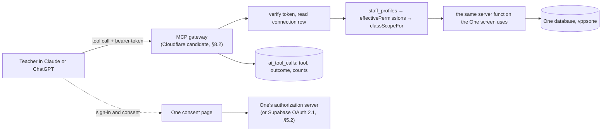

# Teacher AI connection (M01–M03): feasibility and permission design

**Status: design only; owner decisions recorded 3 November 2026.**
This document does not implement code, migrations, credentials, settings or
connections. It is the provider feasibility and permission-design gate for
M01–M03 in `docs/plans/2026-11-03-review-plan-implementation.md`.
The owner's answers and the later correction **admins first, then teachers**
are recorded in §9. Product choices are settled; account-capability tests,
field-policy review and implementation verification are still required.
Provider evidence is dated; a documented capability is not a completed test.

## 1. The short answer

- **Claude: feasible now, for every plan, including Free.** A remote MCP
  server added by URL ("custom connector") works on Free (one connector),
  Pro, Max, Team and Enterprise, on the web, desktop and mobile apps, with each
  teacher signing in to One with their own account. Teachers can add it
  themselves on Free/Pro; on a Team plan only an Owner adds it and each member
  then connects.
- **ChatGPT: full MCP on Business/Enterprise/Edu; Pro read/fetch only.**
  The current official Help Center was readable on 3 November 2026 (G2–G3).
  Free/Plus support for the requested full workflow is not established.
  Build for both providers (D1), but expose only capabilities verified on
  the actual account. No subscription purchase is authorized here.
- **Do not promise one-tap installation.** Guided setup must still respect
  the provider's sign-in, account/workspace policy and consent steps. Verify
  any Claude prefilled-dialog link (C14) in M0; otherwise show clear manual
  steps. No supported equivalent ChatGPT prefill was verified.

- **Free-plan writes are not promised.** Claude's docs place no plan limit on
  write tools, but nothing was tested. ChatGPT's personal plans may be
  read-only or not work at all.
- **Identity reuses One's sign-in, through One's own small OAuth server.**
  Supabase Auth now has an OAuth 2.1 server (beta), but its tokens are the
  teacher's ordinary Supabase session as far as the database is concerned,
  with no custom scopes and no binding to One's MCP address. The recommendation
  (§5.2) is that One issues its own narrow tokens after the teacher signs in
  with their usual One password, so what Anthropic or OpenAI holds opens the
  AI tools and nothing else. Every call re-reads the teacher's staff profile,
  permissions and class scope from One; nothing about identity, role, class or
  session is taken from the AI's request.
- **Privacy remains a release check.** The owner allows personal or work
  accounts and states that admission agreements already cover parental
  consent (D2–D4). This records the owner's assertion, not independent legal
  proof. Verify that the actual notice/agreement covers the provider,
  purpose and permitted fields before enabling pupil-level disclosure.
  Start with admins and aggregate/synthetic data, then teachers within their
  existing per-field and class permissions; never treat “everything related
  to them” as unrestricted database access.

## 2. What the providers support (read 3 November 2026)

**Key:** *Confirmed* = read on the provider's own documentation page.
*Reported* = the official page could not be read (it returned 403 or a
human-verification check); the claim comes from search-engine extracts of
that page or from third parties and must be checked by hand before it is
relied on. *Unknown* = no source found.

### 2.1 Claude (Anthropic)

| # | Claim | Status | Source |
|---|---|---|---|
| C1 | Custom connectors (a remote MCP server added by URL) work on Free, Pro, Max, Ultra, Team and Enterprise; **Free is limited to one** | Confirmed | [Add a connector that isn't in the directory](https://claude.com/docs/connectors/custom/add-unlisted.md); [support article 11175166](https://support.claude.com/en/articles/11175166-get-started-with-custom-connectors-using-remote-MCP) ("Updated this week") |
| C2 | The same connector works in claude.ai, Claude Desktop, the mobile apps and Cowork; "the same connector infrastructure backs all of them" | Confirmed | [Build an MCP server for Claude](https://claude.com/docs/connectors/building/index.md); support article 11175166 |
| C3 | Adding a connector is documented on the web (*Customize › Connectors*); **adding one from the mobile app is not documented** | Unknown | add-unlisted (web steps only) |
| C4 | Team/Enterprise: only Owners and Primary Owners add a custom connector (Enterprise also a custom role with library management); **each member then connects with their own account** | Confirmed | add-unlisted; support article 11175166 |
| C5 | Per-user OAuth; PKCE S256 on every request; a `401` with `WWW-Authenticate: Bearer resource_metadata=…` starts sign-in; RFC 9728 protected-resource metadata whose `resource` equals the server URL; RFC 8414 or OIDC discovery on the authorization server; follows MCP authorization specs 2025-03-26, 2025-06-18, 2025-11-25 | Confirmed | [Authentication for connectors](https://claude.com/docs/connectors/building/authentication.md); building/index |
| C6 | Client registration: a Client ID Metadata Document (CIMD) only if the authorization server advertises `client_id_metadata_document_supported: true` **and** `none` in `token_endpoint_auth_methods_supported`; otherwise Dynamic Client Registration (DCR), which "register[s] a new client on every fresh connection"; or a client ID the admin enters | Confirmed | authentication.md |
| C7 | Redirect URI for web, desktop, mobile and Cowork: `https://claude.ai/api/mcp/auth_callback`; Claude Code uses a loopback redirect on any port | Confirmed | authentication.md |
| C8 | Refresh: Claude refreshes on a `401` and up to five minutes before expiry; needs `invalid_grant` for a dead refresh token; refresh tokens must be rotated for public (DCR/CIMD) clients; asks for `offline_access` if the server lists it; 10 s limit on discovery/registration/token endpoints, 30 s on refresh; no `client_credentials` grant | Confirmed | authentication.md |
| C9 | A static request-header credential (one API key for the whole organisation) is beta for a limited set of organisations and is explicitly "not a person's" credential — **unusable for per-teacher identity** | Confirmed | authentication.md |
| C10 | Server must be reachable on the public internet; Anthropic's traffic comes from `160.79.104.0/21` | Confirmed | authentication.md |
| C11 | Limits on claude.ai and Desktop: tool result ~150,000 characters; 240 s per tool call. Resource subscriptions and sampling are not supported | Confirmed | building/index |
| C12 | Tool annotations: every directory tool needs a `title` and `readOnlyHint: true` or `destructiveHint: true`; "These determine auto-permissions in Claude. Read-only tools can run without per-call confirmation, and destructive tools always prompt." Read and write must be separate tools | Confirmed (stated for directory review; custom connectors run on the same infrastructure) | [Connector pre-submission checklist](https://claude.com/docs/connectors/building/review-criteria.md); [Directory vs custom](https://claude.com/docs/connectors/building/directory-vs-custom.md) |
| C13 | Users can set a tool to **Blocked**, turn a connector off per chat, and choose "Always allow"; in Research mode Claude may call tools without further approval, so Anthropic advises disabling write tools there | Confirmed | add-unlisted; support article 11175166 |
| C14 | **Install link** for a custom connector: `https://claude.ai/customize/connectors?modal=add-custom-connector&connectorName=…&connectorUrl=…` opens the dialog prefilled; "The user reviews the values and confirms before anything is added." Owners have the same link under `admin-settings/connectors` | Confirmed | directory-vs-custom |
| C15 | Directory listing is for public discovery and needs Anthropic review; a private school server stays a custom connector | Confirmed | directory-vs-custom |
| C16 | No documented restriction of write tools by plan; **not tested** | Unknown | — |
| C17 | Commercial products (Team, Enterprise, API): inputs and outputs not used for training by default; a thumbs-up/down stores that conversation up to 5 years (Owners can switch off *Rate chats*); feedback "does not include raw content from connectors" unless copied into the conversation | Confirmed (page dated 18 Aug 2026) | [Is my data used for training?](https://privacy.claude.com/en/articles/7996868-is-my-data-used-for-training) |
| C18 | Free, Pro, Max, Ultra: Anthropic trains on the account's data **when the user's setting is on**; retention 5 years with the setting on, 30 days with it off (stated on the Claude Code data page); commercial standard retention 30 days | Confirmed for training choice; retention figures are from the Claude Code page | [Data usage](https://code.claude.com/docs/en/data-usage.md) |
| C19 | Prices: Pro $20/month ($17 annual); Team Standard seat $25/month ($20 annual), 2–150 seats; admin controls for connectors only on Team and Enterprise | Confirmed (USD; Indian pricing and GST not checked) | [claude.com/pricing](https://claude.com/pricing) |

### 2.2 ChatGPT (OpenAI)

| # | Claim | Status | Source |
|---|---|---|---|
| G1 | A custom MCP server can be added and its tools used in ChatGPT: "Use ChatGPT on the web"; "Workspace permissions and security restrictions, including Lockdown, apply"; "Write actions by default require confirmation"; tools without `readOnlyHint` "are treated as write actions" | Confirmed | [Add custom MCP server](https://developers.openai.com/api/docs/guides/custom-mcp-server.md) |
| G2 | Full custom MCP support is documented for Business and Enterprise/Edu on web; workspace creation/publishing permissions apply. Current setup uses Plugins → Add custom MCP server, without enabling Developer Mode first | Confirmed, read 3 Nov 2026 | [Current Help Center](https://help.openai.com/en/articles/12584461-connecting-custom-mcp-servers-in-chatgpt) |
| G3 | Pro custom servers support read/fetch; full MCP is limited to Business/Enterprise/Edu in the current article. Earlier launch claims and third-party Plus results are not deployment evidence | Confirmed for Pro; Free/Plus full workflow unverified | Current Help Center (G2), “Are apps and full MCP beta available to Pro users?” |
| G4 | Free plan custom MCP; mobile apps; a prefilled install link | Unknown | — |
| G5 | OAuth: OAuth 2.1 per the MCP authorization spec; S256 must be advertised in `code_challenge_methods_supported`; protected-resource metadata; OAuth or OIDC discovery; CIMD preferred, else DCR or a predefined client; echo `resource` throughout; the server must check `aud`/`resource`, `exp`/`nbf` and required scopes on every call | Confirmed | [Authentication](https://developers.openai.com/apps-sdk/build/auth) |
| G6 | Redirect URI: `https://chatgpt.com/connector_platform_oauth_redirect` when the authorization server meets RFC 9207 issuer identification, otherwise `https://chatgpt.com/connector/oauth/{callback_id}` shown on the server's management page | Confirmed | apps-sdk/build/auth |
| G7 | Without `offline_access`, ChatGPT "may lose access after the original authorization expires" | Reported (Help Center extract) | help.openai.com 12584461 |
| G8 | Annotations `readOnlyHint`, `destructiveHint` (host asks for explicit approval), `openWorldHint`, `idempotentHint`; "These hints only influence how ChatGPT or Codex frames the tool call"; the server must enforce its own authorization | Confirmed | [Reference](https://developers.openai.com/plugins/reference.md) |
| G9 | Security guidance: assume prompt injection reaches the server; validate inputs server-side; require human confirmation for irreversible operations; redact PII before logging; include only the data the prompt needs | Confirmed | [Security & Privacy](https://developers.openai.com/plugins/guides/security-privacy.md) |
| G10 | Business, Enterprise, Edu and API: not used for training by default. Personal Free, Plus, Pro: data sharing on by default; the user can switch off *Improve the model for everyone* | Reported (Help Center extracts) | [help.openai.com 8983130](https://help.openai.com/en/articles/8983130-what-if-i-want-to-keep-my-history-on-but-disable-model-training), [5722486](https://help.openai.com/en/articles/5722486-how-your-data-is-used-to-improve-model-performance) |
| G11 | ChatGPT Business: $25 per user per month ($20 annual), from 2 seats | Reported (search extract; the page returned 403) | [openai.com/business/pricing](https://openai.com/business/pricing/) |
| G12 | OpenAI's developer docs now call these "plugins" and the surface "ChatGPT Work"; product names are moving | Confirmed | [Quickstart](https://developers.openai.com/plugins/quickstart.md) |

### 2.3 Supabase Auth as the OAuth server

| # | Claim | Status | Source |
|---|---|---|---|
| S1 | OAuth 2.1 server "is in beta and available on all Supabase plans"; no separate charge; OAuth users count toward MAU | Confirmed | [Getting started](https://supabase.com/docs/guides/auth/oauth-server/getting-started) |
| S2 | Authorization code with PKCE; refresh tokens "may be rotated"; access-token `expires_in` default 3600 s | Confirmed | [OAuth flows](https://supabase.com/docs/guides/auth/oauth-server/oauth-flows) |
| S3 | Public and confidential clients; DCR supported, off in the sample config (`allow_dynamic_registration = false`); **CIMD not documented** — so Claude would fall back to DCR | Confirmed (CIMD: not found) | getting-started; [MCP authentication](https://supabase.com/docs/guides/auth/oauth-server/mcp-authentication) |
| S4 | The app hosts the consent screen: `supabase.auth.oauth.getAuthorizationDetails` / `approveAuthorization` / `denyAuthorization`; the authorization path is set relative to the Site URL | Confirmed | getting-started |
| S5 | Discovery at `https://<ref>.supabase.co/.well-known/oauth-authorization-server/auth/v1`; advice: always require explicit user approval, validate redirect URIs, monitor registered clients | Confirmed | mcp-authentication |
| S6 | Tokens are ordinary Supabase JWTs: `sub`, `role: authenticated`, **`aud: authenticated`**, `client_id`, `session_id`, `exp`; JWKS for verification; with the `openid` scope, HS256 projects cannot mint ID tokens | Confirmed | [Token security](https://supabase.com/docs/guides/auth/oauth-server/token-security); getting-started |
| S7 | Scopes are `openid`, `email`, `profile`, `phone` only — "Custom scopes are not currently supported" and "Scopes control OIDC data, not database access"; resource indicators (RFC 8707) not mentioned | Confirmed | oauth-flows; token-security |
| S8 | RLS applies to OAuth tokens automatically; `auth.jwt() ->> 'client_id'` is null for a direct session; a restrictive policy can shut OAuth clients out of a table; custom access-token hooks run "for all token issuance" | Confirmed | token-security |
| S9 | `revokeGrant(clientId)` (the signed-in user's own grant): "all active sessions and refresh tokens for that client are immediately invalidated"; whether an access token already issued stops working before `exp` is not stated; `listGrants()` exists in supabase-js (One has 2.116) | Confirmed / unknown for live access tokens | oauth-flows; [Dart reference](https://supabase.com/docs/reference/dart/oauth-server-revokegrant) |
| S10 | Supabase's MCP guide expects you to build the MCP server; for Next.js, Vercel's `mcp-handler` 2.x gives a Streamable-HTTP route handler, `withMcpAuth` (the `401` challenge) and the RFC 9728 metadata route, and is resource-server only (needs `@modelcontextprotocol/server` ^2 and zod ^4.2; One has zod 4.6) | Confirmed | mcp-authentication; [vercel/mcp-handler](https://github.com/vercel/mcp-handler) |

### 2.4 What this means for the review plan's gates

| Gate (review plan) | Answer |
|---|---|
| Custom/remote MCP on free and paid plans | Claude: Free limited to one connector (C1). ChatGPT: full MCP Business/Enterprise/Edu; Pro read/fetch; Free/Plus full workflow unverified (G2–G4). Test the actual accounts |
| Mobile clients | Claude: using it on mobile, yes (C2); adding it on mobile, undocumented (C3). ChatGPT: unknown (G4) |
| OAuth | Both require standard per-user OAuth 2.1 with PKCE and discovery (C5–C8, G5–G7). One has no OAuth server today |
| Tool writes | Claude tools supported but target-account writes untested (C12, C16). ChatGPT full workflow depends on eligible plan (G2–G3). Draft creation is a mutation too; do not label it read-only |
| Distribution | Claude: verify individual setup link in M0; Owner-added for Team (C4, C14). ChatGPT: current Plugins setup and workspace publication controls (G2) |
| One-tap | Not promised. Guided provider setup, sign-in and consent are still required; actual mobile/setup paths must be tested |

## 3. Shape of the connection

- **One business authority, optional external gateway.** The original
  co-located Node route remains a fallback. Following the owner's request
  for a zero-additional-hosting-cost option, evaluate a thin Cloudflare
  Workers Free gateway (§8.2). It must invoke One-owned, narrowly scoped
  server adapters that reuse native business functions and permission checks;
  never copy weaker authorization into a worker or expose a generic proxy.
  Authenticate the gateway-to-One hop and bind the verified end-user actor;
  do not trust actor, class or role supplied by the model. Benchmark the
  extra hop and quota/CPU overhead before selecting it. Do not migrate the
  school database to Cloudflare or put a broad database secret in the AI client.
  The separate read-only Fees connector remains a different product (D10).

- **No fee tools.** Fees stays the financial authority (coexistence plan). The
  teacher connection exposes no fee read or write. The owner's existing Fees
  connector keeps answering money questions.
- **Optional by construction.** No page, layout or bundle imports the MCP code;
  switching it off (§5.5) changes nothing a teacher sees in One except the
  connection card.

## 4. What to expose first

Each tool is a thin wrapper over the function the One screen already calls,
with the same permission and scope check, returning a **projection**: a
field list fixed in code and pinned by a test, so a function that returns more
(phone, date of birth, photo path) never passes it through. Paths are as of
`d6c44cb7`.

### 4.1 Reads for the aggregate admin pilot (§6.1)

| Tool | Reuses | Check it keeps | Returns |
|---|---|---|---|
| `school_day_summary` | `loadBoard` / `readBoard` (`src/vx/screens/admin/data.ts:188-266`) | admin Today guard (`src/app/(app)/page.tsx:49`); `readsEveryClass` | per class: marked / unmarked; counts away; periods without cover |
| `who_is_away` (date) | `absencesOn` (`src/modules/substitutions/data/absences-repo.ts:35-62`) | any active staff; the **reason is never returned**, even to `substitutions:manage` | staff name, whole/half day |
| `cover_plan` (date) | `dutiesOn` (`src/modules/substitutions/data/cover-repo.ts:115-128`) | `substitutions:view` | period, class label, absent teacher, substitute |
| `pending_leave` | `askedLeave` (`admin/data.ts:87-102`) | `substitutions:manage` (as loaded at :718) | staff name, dates; no reason |

### 4.2 Reads for teachers (own scope)

| Tool | Reuses | Check it keeps | Returns |
|---|---|---|---|
| `my_day` | `loadHome` (`src/vx/screens/teach/data.ts:441-712`), `periodsOn` (`src/modules/attendance/data/teaching-repo.ts:118-152`), `myDutiesOn` (`src/modules/substitutions/data/duty-repo.ts:88-104`), `myLeaveRows` (`teach/data.ts:213-222`) | `attendance:view` (`src/app/(app)/teach/page.tsx:14`); own rows only | periods, rooms, own cover duties, own leave, which of own registers are unmarked |
| `my_registers` (date) | `ownClassIds` (`teaching-repo.ts:32-53`) + `registersForDay` (`src/modules/attendance/data/attendance-repo.ts:632-646`) | RLS (`attendance:view`, own or all classes) | counts only |
| `my_tasks` | `listTeacherTasks(false)` (`src/modules/teacher-tasks/data/repo.ts:126-158`) | `assertStaff`; assignee only | title, due date, status |
| `staff_notices` | `staffNotices` (`teach/data.ts:85-116`) | none inside today — the tool adds the active-staff check | title, date, text |
| `marks_status` | `marksLinks` (`teach/data.ts:1031-1093`) | own assignments | entered / total / submitted per subject; **never the no-login marks link**, which works as a password |
| `class_roll` (pupil-level release gate, §6.1) | `classRoll` (`attendance-repo.ts:54-109`) | `classScopeFor` (`teaching-repo.ts:95-101`) — callers check scope today, so the tool must | roll number, display name |

### 4.3 No raw repository objects exposed

Raw `loadStudent` / `classInsight` (`teach/data.ts:308-398, 961-1006`: parents'
names, phone, date of birth, photo path, notes), `searchStudents`
(`src/modules/students/data/directory-repo.ts:62-179`: phones; teachers lack
`students:view` anyway), `feeStanding`
(`src/modules/students/data/student-repo.ts:106-150`), anything under
`src/modules/fees/`, the no-login task and marks links (`/t`, `/w`).

D3 additionally requests permitted own-class pupil details, not just names
and roll numbers. Before adding a `student_details` tool, define and test its
exact field projection against the native role/class/subject/field policy
(§6.1). Do not return the raw objects above or grant teachers new access merely
because they connect an AI provider.

### 4.4 Writes to add later

| Write | Server path today | Permission and scope | Idempotency | Gap before the AI may call it |
|---|---|---|---|---|
| Attendance, own class | `saveRegisterVx` (`src/vx/screens/teach/actions.ts:67-166`) → `saveAttendanceAction` checks (`src/app/(app)/teach/actions.ts:81-152`) → RPC `save_attendance_register` | `attendance:mark` **and** class teacher/assistant authority (`src/modules/attendance/domain/attendance.ts:254-283`, re-checked in SQL); session writable | `command_id` unique; `id_reused`; expected revision | None in the data layer. The summary must say that parents of absent pupils get an absence message **queued** (the screen's confirm sheet shows it) |
| Teacher asks for own leave | `requestLeaveVx` (`teach/actions.ts:215-241`); `previewLeaveVx` (:253-271) | own id only | **none** — a plain insert, no unique key | A command id and unique index (a `vppsone` migration) first |
| Admin marks a teacher away | cover command intent `absence` (`src/app/(app)/substitutions/actions.ts:77-155`) | `substitutions:manage`; SQL re-checks active staff | `cover_commands.id`; `id_reused`; stale day revision | `arrangeDay` computes and commits in one go (`src/modules/substitutions/data/arrange-day.ts:227-332`); the prepare step needs its compute half on its own |
| Cover assignment | `arrangeDay` → `commitCoverCommand` (`src/modules/substitutions/data/cover-repo.ts:215-231`) → `commit_cover_command` | `substitutions:manage` | as above | as above; the summary must say substitutes are notified after saving |
| Substitution from a photo, list or voice note | the same cover command — the provider reads the photo; One receives rows | as above | as above | every row must match the timetable; unmatched rows are returned, never guessed |
| Pupil details (review plan: "class teacher may update permitted details") | today only the office opens a collection request (`collection_fields`); the teacher's answers become pending submissions the office accepts (`accept_submissions`) | `collection:*`; fields are data, not code | `record_commands` | **No class-teacher-started request exists.** Through the AI: draft answers to an open request only (D13) |

Not on the list: leave decisions (`decideLeaveAction` writes up to 14 days of
cover at once — keep it in One), marks (not asked for in the review plan).

## 5. Identity

### 5.1 The rule

The AI's request supplies **only** a bearer token and tool arguments. Staff
identity, role, permissions, class scope, TEST/real session and the academic
session label are all derived on the server, on every call, from One's own
tables. No tool argument names a staff member, a role, a session label or
"act as".

### 5.2 The authorization server: two options

Today One has no OAuth server and no bearer-token sign-in for staff. Identity
comes only from the Supabase cookie (`getCurrentStaff`,
`src/platform/auth/current-staff.ts:237`); staff sign in with email and
password; no OAuth or JWT library is installed. Both options keep that
sign-in for the consent step: the teacher signs in to One as usual and
approves on a One page.

| | A. Supabase OAuth 2.1 server (beta) | B. One's own small authorization server |
|---|---|---|
| What it is | Turn on *Authentication › OAuth Server* on wtgx; One hosts the consent page and calls `approveAuthorization` (S4) | One-owned discovery, `/authorize`, `/token`, registration and consent service; hosting selected after the Cloudflare spike (§8.2), not necessarily Next.js |
| What Anthropic or OpenAI holds | A refresh token for a Supabase session of that teacher. Through Supabase's Data API it does whatever the teacher's browser session can, under RLS, until revoked (S6, S8) | A token that opens One's MCP route only, for the scopes granted |
| Scopes and audience | None (S7) | `one.read`, `one.attendance.write`, …; bound to One's MCP URL through the `resource` parameter ChatGPT echoes (G5) |
| Containing a leaked token | Restrictive `vppsone` policies refusing writes when `client_id` is set; fee tables cannot take a policy (rule 2), so it must be shown that the token reads nothing in `public`. A hook could demote the token's `role` instead, but it runs on **every** staff sign-in (S8) and would also stop the RLS reads below | Not needed |
| How tool reads keep the screens' RLS | A request-scoped Supabase client built from the bearer token; `createClient()` reads cookies only today | One keeps a Supabase session per connection, minted at consent through the admin `generateLink` + `verifyOtp` path QA sign-in already uses, refresh token encrypted at rest; fallback: service role with an explicit actor plus a tested scope rule per tool. `my_permissions()` reads `auth.uid()`, so either way it needs a real user token or a service-role twin |
| Disabled staff | Supabase never bans disabled staff, so their token stays valid; RLS helpers and the per-call check refuse them | Per-call check |
| Revocation | `revokeGrant` ends sessions and refresh tokens (S9); a live access token may last an hour, so the route must also check `session_id` per call | Delete the row: the next call fails |
| Claude registration | DCR only (S3): a new client on every fresh connection (C6) | CIMD (Claude's preferred) and DCR |
| Code to own | Consent page, connection table, policies | Plus the authorization and token endpoints, PKCE, refresh rotation, redirect checks, CIMD fetching with SSRF limits, the held session |
| Effort | ~4 days | ~10–12 days |
| Dependency | A beta feature switched on in the production project | None new |

**Technical selection under D5: B, subject to security and runtime verification.**
What Anthropic or OpenAI holds should open the AI
tools and nothing else — the "read-only by construction, not by habit" rule
`docs/cutover/MCP-AND-NOTION.md` set for the fees worker. Supabase's server is
beta, has no scopes or audience, and containing its tokens means new
policies across `vppsone`, none possible on fee tables, or a hook on every
staff sign-in. B costs about a week more and changes no production auth
setting. A stays documented as the fallback. The resource side (§5.3) is the
same under either.

### 5.3 Every call, in order

1. Verify the token: a hash lookup of One's opaque token, unexpired and
   issued for One's MCP URL (B); under A, the JWKS signature, `exp` and a
   `client_id`.
2. Load the connection row (`vppsone.ai_connections`: staff, provider,
   client id, created, last used, revoked). Missing or revoked → `401`.
3. Check the kill switch (§5.5). Off → a tool error that says the school has
   switched the AI connection off.
4. Load the staff profile by auth user id through the same reader
   `getCurrentStaff` uses — today `readCurrentStaff` reads the cookie and is
   cached per request (`current-staff.ts:108-188`), so it needs a variant that
   takes the verified user — including its confinement rule
   (`current-staff.ts:195-204`). `is_active` false, or not eligible for the
   connection → `401`, and the connection is marked revoked. (`is_active` is
   the only state: "left the school" is a reason label recorded when an admin
   disables someone.)
5. `effectivePermissions` for the role; the tool's required permission must be
   held. The tool's scope rule runs (`classScopeFor` for class tools,
   `readsEveryClass` for school-wide ones); arguments are intersected with
   that scope, and anything outside it is refused, not filtered silently.
6. TEST eligibility and isolation: only an authorized admin account may use
   MCP TEST mode (D11); deny teacher/non-admin TEST access server-side, even
   on a confined deployment. Eligible test accounts see only TEST sessions (the
   `test-session-access` rule); on a confined deployment every account is a
   test account (`isConfinedDeployment`); production-ness comes from
   `readEffectiveEnvironment`. Session label from `pickSessionLabel()`, never a
   sort (rule 3a).
7. Run the same server function the One screen runs; log one row (§6.3).

Nothing in steps 2–6 is cached across calls, so a change made in One takes
effect on the teacher's next AI request.

**Route plumbing for the co-located fallback / One adapter.** The proxy sends any cookie-less request outside
`PUBLIC_PREFIXES` (`src/platform/supabase/middleware.ts:84-96`) to `/login`
with a 307, so `/api/mcp`, the `/.well-known/oauth-*` documents and the token
endpoint must join that list and answer `401` themselves (Claude requires the
`401`, C5); `tests/public-routes.test.ts` holds the list. Server actions have
no common authorization wrapper — each calls `assertPermission` /
`assertStaff` (`current-staff.ts:315-339`) — so the MCP tool registry is the
wrapper: each entry names its permission, scope rule, the function it calls
and its projection, and a test walks the registry. For the Cloudflare option,
serve discovery and token challenges at the actual gateway/auth origin;
expose only the explicitly authenticated adapter routes in One. Do not
publicly expose arbitrary server functions.

### 5.4 Lifecycle

| Event | Effect |
|---|---|
| Teacher clicks *Disconnect* in One | Connection revoked; next call `401`; the provider asks them to sign in again |
| Teacher removes the connector in Claude/ChatGPT | The provider drops its token; One cannot see this, so One's card keeps saying "allowed" until expiry or *Disconnect* |
| Admin disables the staff member (`changeStaffAuthority`, `src/app/(app)/staff/vx-actions.ts:192-208`) | Step 4 refuses the next call; that action should also revoke their connections. Supabase does not ban disabled staff, so One's check is the one that counts |
| Role or class-teacher assignment changes (`class_teachers`, edited under `academics:manage`) | Next call uses the new permissions and scope: `classScopeFor` is computed per call, never cached |
| Access token lifetime | 15 minutes (B); Supabase's default would be 1 hour (S2) |
| Refresh token | Rotated on use; a reused old one revokes the connection (B) |
| Connection lifetime | Re-consent after 90 days (D8); rotate refresh tokens for continuity inside that window, warn before expiry, then require reconnection. Connectivity never bypasses expiry/revocation |
| TEST account | Only an authorized admin test account may connect in TEST mode; sees TEST-2026-27 only. Confinement does not waive the admin eligibility check (D11) |
| Lost phone | The teacher or an admin presses *Disconnect* in One |

### 5.5 Switches and limits

- A `runtime_flags` key `ai_connection` (the table's key check needs a
  migration to accept it, as D-359 did for its key), read per call. Off stops
  every tool at once without deleting evidence.
- Eligibility: named admins first, then teachers (D7). One has no per-staff
  permission grants (`role_permissions` is per role); later, a permission such
  as `ai:connect` on the roles the owner chooses.
- Per-staff limits: e.g. 60 calls an hour and 400 a day; result size capped
  well under Claude's ~150,000 characters (C11). AI traffic must never
  compete with the desk.

## 6. Privacy

### 6.1 What may leave One

Everything a tool returns goes to the selected provider under its terms
(C17–C18, G10). D3 expands the desired teacher experience beyond the original
name-and-roll-only ceiling, but not beyond the teacher's existing authority.

| Release stage | Permitted projection | Required boundary |
|---|---|---|
| Admin pilot | Aggregate counts, class labels, staff names in cover plans; synthetic pupil examples in TEST | Named admins only; no real pupil data needed for capability testing |
| Teacher pupil reads | Name, roll number and other expressly permitted details for pupils in the caller's authorized class/subject scope | Fixed per-tool field allowlist; native role/class/subject/field checks on every call; privacy release check below |
| Additional fields | Add only fields justified by the task and permitted by the same native policy; test each field rather than returning entire pupil records | Do not infer new access from D3. No financial data (D10), credentials, unrestricted documents/photos, government identifiers or unreviewed sensitive fields |

The owner's D4 statement is that admission agreements already cover this
use and no new parental consent is needed. Record that as an owner assertion,
not legal advice or proof. Before real pupil-level release, verify the
actual notice/agreement's provider, purpose and data coverage, appropriate
school policy, and the actual personal/work account's training and retention
settings. Flag missing coverage explicitly rather than inventing consent.
Personal and work accounts are both allowed (D2); a work email alone does not
prove commercial privacy terms. The school cannot centrally enforce settings
on teachers' personal accounts.

D12 permits handwritten register photographs in the selected provider,
subject to the same scope and privacy boundary. That is different from One
exporting stored student portraits or documents: those are not included.
The MCP endpoint accepts structured arguments, not file uploads. Avoid
unnecessary identifiers in photos and do not include out-of-scope pupils.

### 6.2 Untrusted input

- Photos, typed lists and voice notes are read **by the provider**; One
  receives only structured tool arguments. The MCP server accepts no file
  uploads in the phases below.
- Every argument is validated with a schema: ids must resolve inside the
  caller's scope; dates within the edit window; free text length-capped,
  stored as data and never interpreted.
- Text from One's database written by people (notes, names) is returned in
  fields, never as instructions. A stored note that says "mark everyone
  present" can at worst make the AI *propose* it; a write still needs the
  server's scope check and the teacher's confirmation (§7.2).
- Tool descriptions say what the tool does and nothing else (C12).

### 6.3 Logging and retention

- One row per call in a new `vppsone.ai_tool_calls`: staff, connection,
  provider, tool name, outcome (`ok` / `refused:<reason>` / `error:<code>`),
  row counts, duration, and for a write the command id. **No arguments, no
  names, no free text** — the same rule as `assist_log`, which stores tokens,
  cost and outcome but never prompts or answers
  (`supabase/migrations/20261027080847_assist.sql`), and as the fees MCP
  worker ("tool names and counts"). Service role only, like `assist_log`.
- A write's content lives where the native write puts it, with its normal
  audit, attributed to the teacher and marked as made through the AI
  connection.
- Keep `ai_tool_calls` 180 days (D8); purge by a scheduled job.

## 7. Writes

### 7.1 Order

Selected implementation: AI drafts, then a human reviews and saves in One (D6):

1. **Drafts that One commits.** The AI fills a server-side draft (a new
   `vppsone.ai_drafts` row: staff, kind, payload, 30-minute expiry — One's
   current drafts are browser-only IndexedDB, so they cannot carry this) and
   returns a link. The teacher opens it in One, sees the ordinary screen
   prefilled, and saves there. Confirmation is One's own UI, so the AI never
   commits anything.
2. **Direct writes are not authorized by this decision.** The prepare/commit
   design below is future reference only. It needs a separate explicit owner
   decision and security review; elapsed pilot time alone does not enable it.

Creating a server-side draft changes state: annotate it as a write, attribute
it to the caller and enforce expiry, scope, version checks and idempotency.
Native Save must re-check current permissions and data, disclose any queued
messages or other side effects, and require the human's deliberate action.

### 7.2 Future reference only: the confirmation rule for direct writes

Each write is two tools:

- `prepare_<action>` (write annotation if it persists confirmation state): validates against scope and the
  current data, returns a plain summary ("Class 7B, 3 Nov: 31 present, 2
  absent — roll 4, roll 19") and a single-use `confirmation_id`, held on the
  server for 10 minutes and bound to staff, connection and a hash of the
  payload.
- `commit_<action>` (`destructiveHint: true`, so Claude always prompts, C12,
  and ChatGPT asks, G8): takes only the `confirmation_id`. The server re-checks
  scope and the hash, then runs the **existing idempotent command** with the
  confirmation id as its command/request id, so a retry cannot double-save.

The tool description tells the AI to show the summary and wait for the
teacher's yes; the host prompt is a second layer; the server-side binding is
the one that holds whatever the AI does.

### 7.3 Exclusions for this connection

Fee reads or writes, parent or staff messages (WhatsApp sends), deletions,
staff/role/permission changes, settings, imports, raw SQL or any generic
query or edit tool, stored document or photograph export, anything outside
the caller's scope, anything across the TEST/real boundary.

## 8. Phased build plan, effort and running cost

Effort is for one developer working in this repo with an AI agent, in working
days, excluding the owner's own testing.

| Phase | Scope | Gate to start | Effort |
|---|---|---|---|
| **M0 Spike** | Confined preview/synthetic TEST data; eligible admin accounts only (D11). Test both providers on the actual available plans, web/mobile setup, read tools, draft capability, refresh, revoke and disabled-staff denial. Verify Cloudflare runtime, CPU, request/storage quotas and the authenticated One adapter. Do not buy accounts or create persistent credentials without the required action-time approval | D1/D11 recorded; exact account tiers and permissions still to verify | 3–4, re-estimate after spike |
| **M1 Read-only admin pilot** | B (§5.2), consent, connection records, metadata-only logs, kill switch, named admins, §4.1 tools, per-tool parity tests and pinned projections; provider-neutral implementation with only verified provider capabilities enabled | M0 passed; security tests and hosting decision evidenced | 12–16 |
| **M2 Teacher reads** | After admin pilot, teacher access using existing permissions; §4.2 plus explicitly projected own-class details under §6.1; guided setup for both supported providers, truthful status, Disconnect, limits | M1 has run ≥ 2 weeks; pupil-field/privacy release checks complete; actual teacher account capability proven | 5–7, re-estimate field scope |
| **M3 Drafts and human Save** | Scoped, expiring server-side drafts for attendance, authorized leave/cover work and existing collection responses; open in One, review, explicit Save; no direct model commits | D6/D13; native validation, side-effect disclosure, concurrency and idempotency tests | 5–7 |
| **M4 Direct writes — deferred** | Future prepare/commit reference only; not selected by “drafts first, then save” | Separate explicit owner decision and review; not enabled by elapsed time | Not included in authorized build estimate |
| **Provider validation** | Same domain/permission contract for Claude and ChatGPT; callback/discovery compatibility and actual account capability matrix; show unsupported/read-only capabilities honestly | M0 evidence; D1 both | Included throughout; original 2–3 days for ChatGPT was only an estimate |

The original 7–9-week estimate included direct writes and a different
co-located architecture. Do not quote it as the completion estimate for this
revised scope. Re-estimate after M0, including Cloudflare adapter overhead,
the expanded per-field read policy, and actual provider constraints.

### 8.1 The connection card in One

States come only from One's records, never guessed:

- **Not connected** — no connection row.
- **Allowed — last used 10:42 today** — row present; time from `ai_tool_calls`.
- **Allowed — not used for 30 days** — prompts *Disconnect* if unwanted.
- **Switched off by the school** — the kill switch is off.
- **Disconnected** — by the teacher or an admin, with the date.
- **Reconnect required** — grant expired/revoked or re-consent is due.
- **Unavailable on this account** — capability not supported or not verified.

One cannot know whether the connector is still installed in Claude or ChatGPT,
so the card says "allowed" and "last used", never "connected and working".

### 8.2 Hosting and running cost: conditional free recommendation

**Recommend evaluating Cloudflare Workers Free for a thin, authenticated,
stateless Streamable-HTTP gateway and isolated MCP authorization service.**
The official [remote MCP guide](https://developers.cloudflare.com/agents/model-context-protocol/guides/remote-mcp-server/)
documents a stateless handler with no mandatory Durable Object. Persistent
authorization state still needs durable storage; “stateless transport” does
not mean disposable grants or revocation records.

Read 3 November 2026: [Workers Free limits](https://developers.cloudflare.com/workers/platform/limits/)
are 100,000 requests/day, 10 ms CPU/request, 128 MB memory and 50 outgoing
subrequests/request. Network wait is not CPU time. Authentication, validation
and payload processing must be measured against the CPU allowance; account
limits include other workers too. Fail closed on exhaustion and leave native
One working. No automatic paid upgrade or unlimited-free promise.

Keep business data and authority in One. The gateway calls narrowly scoped,
authenticated One adapters; compare latency and existing backend costs with
the original co-located Node fallback. Do not migrate the school database or
route its normal UI through the gateway. OCR/model work stays in the AI
client, not the Worker. Select and benchmark a transactional store for
single-use authorization codes, refresh rotation/reuse detection and
immediate revocation; never rely solely on eventually consistent caches for
these guarantees. Storage, retention and scheduled cleanup have separate
quotas to verify before rollout.

Free hosting is not free unlimited service: provider account limits,
provider plan eligibility, existing One/Vercel/database usage and optional
school-paid seats remain separate. MCP itself need not invoke a separately
billed model API. Do not purchase a subscription or turn on paid overages
under this document. If the free budget is insufficient, report measurements
and options rather than silently degrading authorization or purchasing more.

### 8.3 Evidence required before declaring a phase done

- Record exact commit, deployment, provider/account tier, test date and
  observed capability; no real pupil data in test fixtures, screenshots or logs.
- Cross-role/class/session and field tests, disabled staff, revocation,
  90-day re-consent, refresh replay, duplicate drafts and stale human Save.
- Admin-only TEST denial for teachers and non-admins, including preview.
- Both providers' actual setup paths; unavailable plans produce honest UI,
  never a false connected indicator or a read-only-labelled draft mutation.
- Gateway CPU/latency/quota measurements; database/source isolation and no
  slowdown in native One when the gateway is unavailable.
- No business changes, production configuration or provider connection is
  implied by merging this document.

## 9. Owner decisions recorded on 3 November 2026

These answers replace the earlier recommendation-only table. D7 uses the
owner's later correction, **“Admins first then teachers”**, not the earlier
“admission” typo. D11 answers who may test, not which provider plan is
available. This is a design record, not proof of implementation or authority
to bypass credential, privacy, purchase or deployment controls.

| # | Owner answer | Implementation interpretation and remaining verification |
|---|---|---|
| D1 | “Both” | Support Claude and ChatGPT through the same scoped contract. Enable only capabilities verified on the actual account; do not promise Free/Plus ChatGPT writes |
| D2 | “Teachers can use both there personal or work” | Permit personal or work accounts, each linked to that teacher's own One identity. Account-specific provider terms/settings apply; no school-paid-seat purchase implied |
| D3 | “allow a teacher to see name and roll and everything related to them” | Own authorized pupils and permitted related details, enforced by native role/class/subject/field policy. Explicit field projections, no unrestricted pupil object or financial tools; see §6.1 |
| D4 | “Checked , no consent needed , parents agree to these when they sought admission” | Owner asserts admission agreements cover this use. Record the assertion; do not certify legal sufficiency. Verify actual provider/purpose/data coverage and policy before real pupil disclosure |
| D5 | “Which ever works the best” | Technical choice delegated. Prefer One-owned MCP-scoped authorization B; evaluate Cloudflare Free deployment under §8.2, with security and runtime evidence before commitment |
| D6 | “Drafts first , then save” | AI prepares a draft; an authorized human reviews and explicitly saves in One. Direct model commit tools are deferred, not implicitly approved |
| D7 | “Admins first then teachers” (later correction) | Named admin pilot first; teacher rollout after validated permissions, privacy and provider capability gates. Not admissions-first |
| D8 | “Both, as long as connectivity is there” | Keep metadata-only tool logs 180 days and re-consent every 90 days. Refresh rotation maintains continuity inside the grant window; clear reconnect UX at expiry. No indefinite or non-revocable grant |
| D9 | “Yes” | Owner/admin kill switch and disconnect-other-user controls; users may disconnect their own connection |
| D10 | “Keep them separate” | Existing Fees connector stays separate for authorized owner/accountant use. No One MCP fee tools; native One fee parity is a separate workstream |
| D11 | “Only admins account can use test” | Enforce admin-only MCP TEST eligibility on the server, including confined deployments. Actual Claude/ChatGPT test account tiers are still unverified; no purchase or teacher TEST access implied |
| D12 | “yes” | Handwritten register photos may be supplied to the permitted provider within pupil scope/privacy policy. AI extracts structured draft arguments; One MCP accepts no uploaded files and exports no pupil portraits |
| D13 | “use existing flow” | Preserve office request → teacher response → office acceptance. AI drafts responses to existing requests; no new teacher-initiated direct pupil edit bypass |

Open execution prerequisites are evidence, not a request to answer these
13 product choices again: actual provider-account capabilities, an explicit
per-field tool policy, the admission-notice coverage check, secure hosting
measurements and approval for any new persistent credentials.

## 10. Found on the way (not changed here)

- `/teach/student/[id]` shows a pupil's dues (`feeStanding`) to anyone with
  `collection:view` (`src/app/(app)/teach/student/[id]/page.tsx:128,138`).
  The rule that a teacher never gets `fees:*` (`permissions.ts:387-391`) does
  not cover it, because the name does not start with `fees:`. Harmless while
  no teacher role holds `collection:view`.
- `assist_log` has no purge job, so it is kept forever today.
- `requestLeaveVx` inserts with no idempotency key, so a retried request can
  file twice.

## 11. Not done by this documentation update

No code, migrations, environment variables, production settings, credentials,
provider connections, subscription purchases or deployments are changed.
The current ChatGPT Help Center was readable for the G2/G3 update; actual
account tests remain unperformed by this documentation task. Original
code-path findings in §10 are historical findings, not claims that the
current implementation was re-audited here.

Only this plan document is changed. `docs/PROGRESS.md` is deliberately not
modified by this documentation-only PR. Implementation must track its own
verification evidence and progress; owner decisions do not mean M01–M03
are built or live.
